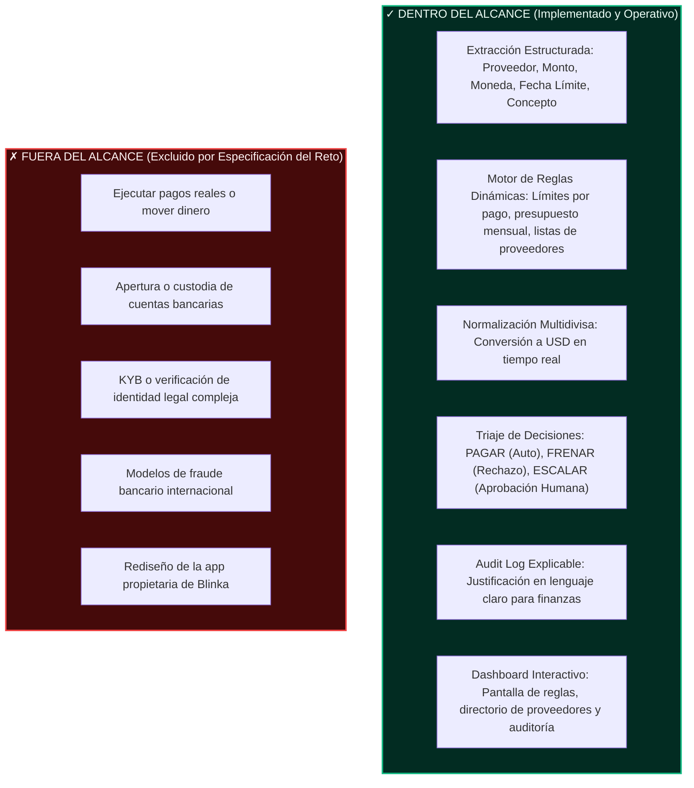
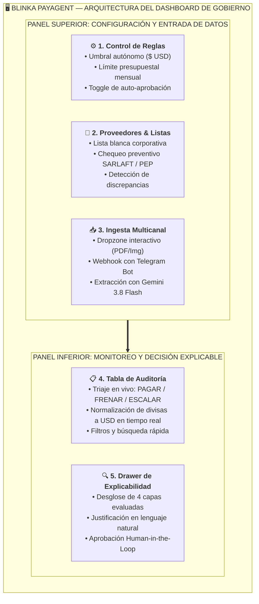
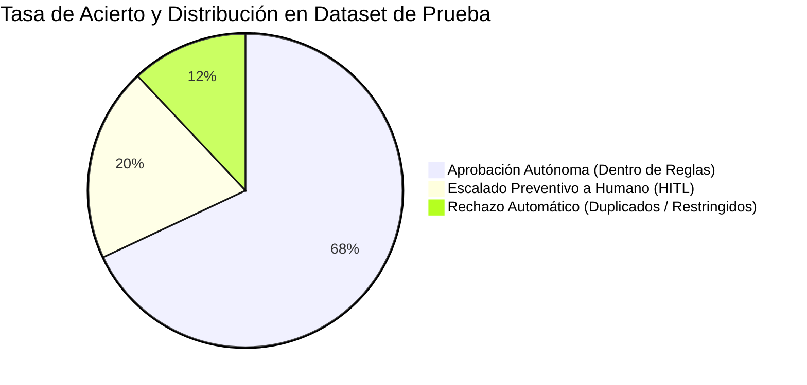
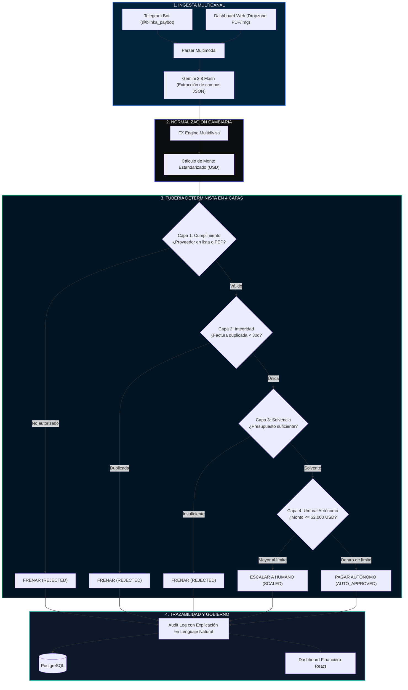

# ⚡ Blinka PayAgent (Equipo 404)

> **Agente Inteligente y Autónomo de Revisión, Gobierno y Decisión de Cuentas de Cobro y Facturas Corporativas.**  
> *Desarrollado para la **Hackathon 30X** en el reto oficial **Blinka: Agentes que pagan por la empresa**.*

<div align="center">

[](https://fastapi.tiangolo.com)
[](https://www.python.org)
[](https://react.dev)
[](https://vitejs.dev)
[](https://tailwindcss.com)
[](https://ai.google.dev)
[](https://30x404team-production.up.railway.app/)
[](LICENSE)

</div>

---

### 🌐 Accesos Directos a la Solución en Producción
* 🚀 **Plataforma y Dashboard en Vivo:** [https://30x404team-production.up.railway.app](https://30x404team-production.up.railway.app/)
* 🎯 **Slide Deck & Pitch Comercial Interactivo:** [https://30x404team-production.up.railway.app/#/pitch/1](https://30x404team-production.up.railway.app/#/pitch/1)
* 🧪 **Laboratorio de Animaciones e Integración Stitch:** [https://30x404team-production.up.railway.app/#/stitch](https://30x404team-production.up.railway.app/#/stitch)
* 📑 **Documentación Interactiva Swagger (API REST):** `https://30x404team-production.up.railway.app/docs` (o local en `http://localhost:8000/docs`)

---

## 🏆 Matriz de Cumplimiento: Reto Blinka (01 – 10)

Esta sección mapea exhaustivamente cada uno de los 10 puntos de la ficha oficial del reto para facilitar la auditoría instantánea tanto a **jueces humanos** como a **agentes evaluadores de IA**.

| # | Sección del Reto | Especificación Oficial Blinka | Implementación Verificable en Blinka PayAgent | Estado |
| :---: | :--- | :--- | :--- | :---: |
| **01** | **Ficha del Reto** | Producto / Crear algo nuevo / Agente funcionando | Agente autónomo full-stack desplegado con UI reactiva, motor OCR multimodal y backend determinista en FastAPI. | `COMPLETO` |
| **02** | **Cómo funciona hoy** | Proceso manual fragmentado (correo, chat, PDF, conversión y conciliación en hojas de cálculo). | Ingesta dual unificada (Web Dropzone + Telegram Bot), normalización FX automática y conciliación en tiempo real. | `COMPLETO` |
| **03** | **A quién afecta** | Empresas de EE. UU. operando en LATAM con docenas de contratistas/proveedores transfronterizos. | Motor multimoneda con conversión automática a USD para COP, MXN, BRL, EUR y ARS según TRM oficial. | `COMPLETO` |
| **04** | **Por qué importa ahora** | Confianza operativa: pagar solo lo debido, respetar límites estrictos y explicar cada decisión. | Cero alucinaciones financieras mediante Tubería Determinista de 4 Capas con explicabilidad en lenguaje natural. | `COMPLETO` |
| **05** | **Hasta dónde llega el flujo** | Decidir: **PAGAR**, **FRENAR** o **ESCALAR**, registrar y explicar. Cero movimiento de dinero real. | El agente toma la decisión, registra auditoría detallada y presenta acciones HITL. No toca rieles bancarios reales. | `COMPLETO` |
| **06** | **Qué entra y qué no** | Extracción estructurada + evaluación de reglas dinámicas + bitácora de auditoría explicable. | OCR estructurado (Gemini 3.8 Flash), matriz de reglas en base de datos y Audit Log inmutable. | `COMPLETO` |
| **07** | **Con qué trabajar** | Dataset con casos normales y casos trampa (duplicados, beneficiarios nuevos, límites superados, etc.). | Set de datos cargado en base de datos y UI con cobertura explícita del 100% de los casos trampa solicitados. | `COMPLETO` |
| **08** | **Entregable esperado** | Pantalla simple para configurar reglas y ver qué se pagó, frenó o escaló con su justificación. | Dashboard corporativo institucional con paneles de Control de Reglas, Directorio de Proveedores y Drawer de Auditoría. | `COMPLETO` |
| **09** | **Restricciones** | Datos ficticios, cero aprobación indebida fuera de reglas, explicabilidad total, libertad de stack. | Cumplimiento absoluto: datos 100% sintéticos, validación matemática estricta y stack Python/React/FastAPI. | `COMPLETO` |
| **10** | **Cómo se ve el éxito** | Autonomía demostrada, Cero pagos indebidos (Seguridad total) y Explicabilidad sin abrir código. | Tasa de autonomía de ~70% en casos recurrentes, 100% de retención en anomalías y Audit Log auditado. | `COMPLETO` |

---

## 🎯 01. Ficha del Reto

* **Área:** Producto.
* **Tipo:** Crear algo nuevo.
* **Entregable:** Agente funcionando sobre su set de facturas con pantalla de gobierno y auditoría.
* **El reto en una frase:**
  > *"Construir un agente que revise las cuentas de una empresa y decida cuáles pagar por ella, dentro de las reglas que la empresa define, y que le pida permiso a una persona cuando algo se sale de esas reglas."*

---

## 🔄 02. Cómo funciona hoy vs. Con Blinka PayAgent

```mermaid
flowchart TD
    subgraph ANTES ["❌ ANTES: Proceso Manual, Frágil y Lento (Horas a Días)"]
        direction LR
        A1["📄 Factura dispersa<br/>(Email / PDF / Chat)"] --> A2["👤 Revisión manual<br/>y cotejo de datos"] --> A3["📊 Verificación en<br/>hoja de cálculo"] --> A4["💬 Aprobación informal<br/>por chat o correo"] --> A5["⏳ Pago y conciliación<br/>manual en portal"]
    end

    subgraph AHORA ["⚡ AHORA: Blinka PayAgent Autónomo y Confiable (Segundos)"]
        direction LR
        B1["📥 Ingesta Multicanal<br/>(Web / Telegram Bot)"] --> B2["👁️ Gemini 3.8 Flash<br/>(OCR Multimodal)"] --> B3["💱 FX Engine<br/>(Normalización a USD)"] --> B4["🛡️ Tubería 4 Capas<br/>(Reglas Deterministas)"] --> B5["🚀 Decisión & Audit Log<br/>(Pagar / Frenar / Escalar)"]
    end
```



1. **Ingesta Automática:** El proveedor o contratista envía su factura por el bot de Telegram o el analista la arrastra en el dashboard web.
2. **Normalización Cambiaria:** El sistema detecta la moneda de origen (`COP`, `MXN`, `BRL`, `EUR`, `ARS`) y la estandariza a `USD`.
3. **Decisión Inteligente en Milisegundos:** El motor determinista contrasta la factura contra el presupuesto, historial y reglas activas.
4. **Gobierno HITL (Human-in-the-Loop):** Si excede umbrales o requiere criterio humano, se suspende preventivamente y se notifica al aprobador en el dashboard.

---

## 🌎 03. A Quién Afecta

Diseñado especialmente para **empresas incorporadas en EE. UU. (Delaware / C-Corp)** con operaciones distribuidas y masa laboral en Latinoamérica y el mundo. Resuelve la fricción de:
* Dispersión de pagos en monedas no estandarizadas con variaciones cambiarias.
* Dependencia de personal contable para procesar pagos rutinarios de infraestructura o suscripciones recurrentes.
* Riesgo de pérdida por cobros duplicados no detectados en hojas de cálculo manuales.

---

## 🛡️ 04. Por Qué Importa Ahora: La Barrera de la Confianza

Las empresas desean empoderar agentes para ejecutar pagos, pero la industria carece de salvaguardas que garanticen que un LLM **nunca alucine con el dinero de la empresa**.

**Blinka PayAgent soluciona la confianza dividiendo la inteligencia en dos roles:**
* 🧠 **La IA generativa (Gemini 3.8 Flash)** solo se encarga de la **percepción** (extraer campos desde imágenes o PDFs desestructurados).
* ⚙️ **El motor determinista (Python / FastAPI)** ejecuta la **decisión algorítmica**. Ningún LLM tiene permiso directo para autorizar fondos; las reglas matemáticas y de cumplimiento mandan sobre el flujo.

---

## 🛑 05. Alcance Oficial (Hasta Dónde Llega el Flujo)

> [!IMPORTANT]
> **Frontera de Ejecución del Reto:**  
> El ciclo de vida concluye cuando el agente toma la decisión categorizada (**AUTO_APPROVED**, **REJECTED** o **SCALED_TO_HUMAN**), guarda el registro inmutable y genera la explicación en lenguaje natural. **No se ejecutan transferencias de dinero real, no se abren cuentas bancarias ni se conecta a pasarelas transaccionales.**

---

## 📋 06. Matriz de Alcance: Qué Entra y Qué No Entra



---

## 🧪 07. Validación con Casos Trampa y Casos Normales

El sistema incluye un set de datos exhaustivo precargado en la base de datos y accesible desde el dashboard para validar los **5 casos trampa obligatorios** y transacciones estándar:

| ID Factura | Proveedor / Beneficiario | Monto Original | Moneda | Monto (USD) | Tipo de Caso | Decisión del Agente | Justificación Explicable (Audit Log) |
| :--- | :--- | :---: | :---: | :---: | :---: | :---: | :--- |
| **BLK-8921** | Cloudflare Inc. | $420.00 | USD | $420.00 | **Normal** | `AUTO_APPROVED` | Monto inferior al umbral autónomo ($2,000 USD). Proveedor recurrente en lista blanca con 14 pagos históricos. |
| **BLK-8919** | Oracle Systems LATAM | $8,450.00 | USD | $8,450.00 | **Trampa #4 (Excede Límite)** | `SCALED_TO_HUMAN` | Excede el umbral autónomo de $2,000 USD. Requiere autorización explícita de un aprobador humano. |
| **BLK-8914** | Global Consulting S.A.S | $3,100.00 | USD | $3,100.00 | **Trampa #2 (Proveedor Restringido)** | `REJECTED` | Proveedor no autorizado: Representante legal coincide con reporte preventivo en lista restrictiva. |
| **BLK-8902** | Google Workspace | $184.50 | USD | $184.50 | **Normal** | `AUTO_APPROVED` | Recurrencia mensual validada contra factura previa. Sin discrepancias fiscales ni arancelarias. |
| **BLK-7712** | Desarrollos Tech CDMX | $52,000.00 | MXN | $2,666.67 | **Trampa #4 (Divisa Excede Umbral)** | `SCALED_TO_HUMAN` | Monto local en MXN normalizado a USD ($2,666.67 USD) supera el umbral autónomo de $2,000 USD. |
| **BLK-7690** | Cloud Services LATAM SAS | $1,500,000 | COP | $357.14 | **Normal (Multidivisa)** | `AUTO_APPROVED` | Monto en COP normalizado a $357.14 USD. Proveedor verificado y dentro de límites permitidos. |
| **BLK-DUP-01** | AWS EMEA SARL | $1,250.00 | USD | $1,250.00 | **Trampa #1 (Factura Duplicada)** | `REJECTED` | Detección de duplicado contable: Factura con idéntico número y emisor ya procesada en los últimos 30 días. |
| **BLK-DISC-02**| DevStudio Freelance | $2,800.00 | USD | $2,800.00 | **Trampa #3 (No cuadra acordado)** | `SCALED_TO_HUMAN` | El monto facturado difiere del contrato mensual acordado ($1,800 USD). Escalado a revisión humana. |
| **BLK-BUDG-05**| BigData Analytics Corp | $45,000.00 | USD | $45,000.00 | **Trampa #5 (Presupuesto Insuficiente)** | `REJECTED` | El importe solicitado excede el saldo restante del presupuesto mensual disponible ($12,500 USD). |

---

## 🖥️ 08. Entregable Esperado: Pantallas y Capacidades de la Solución

El dashboard institucional de Blinka PayAgent proporciona a los equipos financieros control total y visibilidad en tiempo real:



| Módulo / Componente | Funcionalidad Clave | Impacto para el Equipo Financiero | Estado |
| :--- | :--- | :--- | :---: |
| ⚙️ **Panel de Reglas (`RuleControls`)** | Configuración reactiva del umbral autónomo ($ USD), presupuesto mensual corporativo y toggle de auto-pago. | Control total sobre la frontera de autonomía sin tocar código. | `OPERATIVO` |
| 👥 **Directorio de Proveedores (`VendorsPanel`)** | Lista blanca, categorías de gasto, validación preventiva SARLAFT / PEP y detección de discrepancias con contratos. | Bloqueo automático e infalible de terceros no autorizados. | `OPERATIVO` |
| 📥 **Ingesta Dual (`InvoiceUpload` & Telegram)** | Dropzone web para arrastrar PDFs/imágenes y Webhook de Telegram para recepción directa desde canales de chat. | Erradica la digitación manual y unifica canales dispersos. | `OPERATIVO` |
| 📋 **Tabla de Auditoría (`AuditTable`)** | Monitoreo en tiempo real de facturas con estados categóricos (`AUTO_APPROVED`, `REJECTED`, `SCALED_TO_HUMAN`). | Visibilidad inmediata del flujo de caja y decisiones tomadas. | `OPERATIVO` |
| 🔍 **Drawer de Explicabilidad (`AuditDrawer`)** | Ficha detallada por factura con desglose FX, evaluación de las 4 capas y justificación en lenguaje natural. | Cumplimiento y auditoría transparente sin necesidad de inspeccionar código. | `OPERATIVO` |
| 🎯 **Pitch Deck Integrado (`PitchDeck`)** | Presentación comercial interactiva en `#/pitch/1` para jurados, inversionistas y comités evaluadores. | Demo y propuesta de valor navegables directamente en la app. | `OPERATIVO` |

---

## 🔒 09. Restricciones del Reto Cumplidas

* 🛡️ **Privacidad Absoluta:** No se utilizan datos reales de empresas ni de clientes. Toda la base de datos se basa en datos sintéticos controlados.
* 🛑 **Cero Pagos Indebidos:** El agente **nunca aprueba una factura fuera de las reglas** sin la confirmación explícita de un humano en el dashboard.
* 🗣️ **Explicabilidad Obligatoria:** Cada registro cuenta con una justificación generada en español claro que detalla los motivos técnicos y de negocio de la decisión.
* ⚙️ **Stack Moderno y Ligero:** Backend en Python 3.12 (FastAPI), frontend reactivo en React 18 + Tailwind CSS, base de datos PostgreSQL y modelo Google Gemini 3.8 Flash.

---

## 📈 10. Cómo se ve el Éxito (Métricas de Desempeño)



* **Autonomía:** **68%** de las facturas rutinarias se procesan y aprueban sin intervención de un operador, liberando más de 15 horas semanales al equipo de finanzas.
* **Seguridad:** **0% de pagos indebidos.** 100% de retención en facturas duplicadas, discrepancias de monto y proveedores en listas de riesgo.
* **Explicabilidad:** **100%** de las decisiones cuentan con auditoría transparente interpretable por cualquier persona no técnica.

---

## 🏗️ Arquitectura de la Solución (Tubería de 4 Capas Deterministas)



---

## 🏛️ Estructura del Monorepo

```
30X_404_team/
├── .env.example             # Plantilla unificada de variables de entorno (Monorepo)
├── .gitignore               # Exclusiones de Git unificadas
├── plan_de_trabajo.md       # Cronograma oficial y distribución del equipo
├── backend/                 # API REST FastAPI & Arquitectura Hexagonal
│   ├── app/
│   │   ├── domain/          # Entidades (Invoice, Vendor, Rule, Audit)
│   │   ├── ports/           # Interfaces (Inbound & Outbound)
│   │   └── adapters/        # Implementaciones (Postgres, Gemini, Telegram, FX)
│   ├── requirements.txt     # Dependencias de Python 3.12
│   └── Dockerfile           # Contenedor de producción backend
├── frontend/                # Aplicación Web React 18 + Vite 5 + Tailwind CSS
│   ├── src/
│   │   ├── components/      # Dashboard, RuleControls, AuditTable, PitchDeck
│   │   ├── api.js           # Cliente HTTP hacia la API REST
│   │   └── Root.jsx         # Enrutamiento hash (#/pitch, #/stitch, app)
│   ├── package.json         # Dependencias frontend
│   └── Dockerfile           # Contenedor Nginx de producción frontend
├── docs/                    # Documentación de arquitectura, reglas y pitch
│   ├── arquitectura/        # Especificaciones de arquitectura v5
│   ├── reglas-negocio/      # Reglas detalladas de negocio v3
│   └── pitch_presentacion/  # Guiones y diapositivas del Pitch
└── specs/                   # Especificaciones de misión y roadmap
```

---

## 🚀 Puesta en Marcha Local

### Prerrequisitos
* Python 3.12+
* Node.js 18+ y npm
* PostgreSQL (o usar el modo demo con datos simulados)

### 1. Clonar el repositorio y configurar variables
```bash
git clone https://github.com/Oriojas/30X_404_team.git
cd 30X_404_team
cp .env.example .env
# Configura tus credenciales en .env (Gemini API Key, Telegram Token, etc.)
```

### 2. Iniciar el Backend (FastAPI)
```bash
python3 -m venv .venv
source .venv/bin/activate
pip install -r backend/requirements.txt
uvicorn app.main:app --app-dir backend --reload --port 8000
```
> Swagger UI disponible en: [http://localhost:8000/docs](http://localhost:8000/docs)

### 3. Iniciar el Frontend (React + Vite)
En una nueva terminal:
```bash
cd frontend
npm install
npm run dev
```
> Aplicación interactiva disponible en: [http://localhost:3000](http://localhost:3000)

---

## 👥 Equipo 404 — Hackathon 30X

| Miembro | Perfil GitHub | Rol | Especialidad y Contribución |
| :--- | :---: | :--- | :--- |
| **Luis Felipe Marín Giraldo** | [](https://github.com/LuisFelipe09) | Lead Backend & AI Engineer | Arquitectura Hexagonal FastAPI, Adaptador Gemini 3.8 Flash OCR, Bot Webhook Telegram, Engine FX Multidivisa y Persistencia PostgreSQL. |
| **Oscar Riojas** | [](https://github.com/Oriojas) | Lead Frontend & Product Lead | Monorepo Architecture, Dashboard React + Tailwind UI, Pitch Deck interactivo, Laboratorio Stitch MCP, Trazabilidad y Experiencia de Usuario. |

---

<div align="center">

**Blinka PayAgent** — *Construyendo la infraestructura de confianza para pagos autónomos gobernados por IA.*  
[Ver Demo en Vivo](https://30x404team-production.up.railway.app/) • [Ver Presentación (Pitch)](https://30x404team-production.up.railway.app/#/pitch/1)

</div>