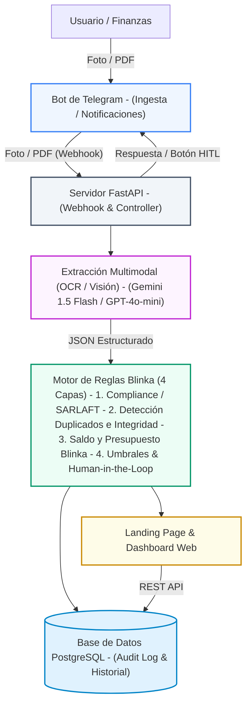
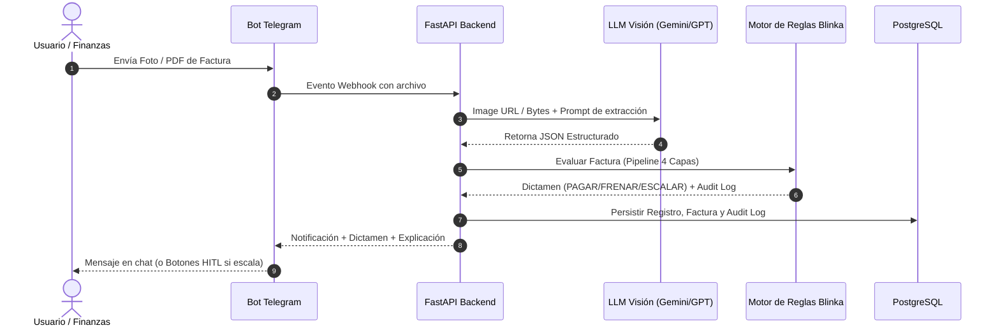

# Documento de Arquitectura de Sistema: Blinka PayAgent

## 1. Visión General del Sistema

**Blinka PayAgent** es un agente autónomo de inteligencia financiera diseñado para resolver el cuello de botella operativo en el procesamiento de facturas y cuentas de cobro para empresas globales en Latinoamérica. 

El sistema combina ingesta conversacional multicanal (Telegram), análisis visual multimodal (OCR + LLM), un motor de reglas determinista en 4 capas (Compliance/SARLAFT, Integridad, Solvencia y Gobernanza HITL) y un panel web de auditoría y configuración desplegado de forma unificada.

---

## 2. Componentes del Sistema

### A. Capa de Ingesta y Comunicación (Bot de Telegram)
* **Función:** Punto de contacto con los usuarios y el equipo operativo de finanzas.
* **Capacidades:**
  * Recepción instantánea de imágenes (JPG, PNG) y documentos PDF de facturas.
  * Envío automático del dictamen (`AUTO_APPROVED`, `SCALED_TO_HUMAN`, `REJECTED`) con explicación en lenguaje natural.
  * Botones interactivos integrados (*Inline Keyboards*) para permitir la aprobación/rechazo manual instantáneo por parte del operador humano cuando una factura es escalada (`SCALED_TO_HUMAN`).

### B. Capa de Procesamiento Multimodal y OCR (LLM Vision Engine)
* **Función:** Transforma documentos no estructurados (imágenes/PDFs) en datos estructurados verificables.
* **Mapeo de Datos Extraídos:**
  * `vendor_name` (Razón Social del Proveedor)
  * `tax_id` (NIT / RUT / Tax ID)
  * `invoice_id` (Número de Factura)
  * `amount` & `currency` (Monto y Moneda: USD, COP, MXN)
  * `issue_date` & `due_date` (Fechas de Emisión y Vencimiento)
  * `bank_account_info` (Datos bancarios del beneficiario)
  * `confidence_score` (Puntaje de confianza en la extracción)

### C. Capa de Lógica de Negocio: Motor de Reglas de Blinka (4 Capas)
Ejecución en canalización secuencial determinista:
1. **Capa 1 (Compliance & SARLAFT):** Verificación automática contra listas restrictivas (OFAC/ONU), prevención de listas negras y alertas de cuentas bancarias no autorizadas.
2. **Capa 2 (Integridad & Datos):** Control de cobros duplicados (mismo ID + proveedor o mismo monto en < 30 días), validación de discrepancias en tarifas y calidad de extracción OCR (>85%).
3. **Capa 3 (Solvencia & Presupuesto):** Verificación de saldo suficiente en la cuenta Blinka y respeto de topes presupuestales del período.
4. **Capa 4 (Gobierno & Human-in-the-Loop):** Evaluación de umbrales autónomos (límite configurable de $2,000 USD), detección de proveedores nuevos y nivel de ambigüedad acumulado.

### D. Capa de Persistencia e Historial (PostgreSQL)
* **Modelos de Datos:**
  * `Invoices`: Registro de cada factura procesada, datos extraídos, estado final y timestamp.
  * `AuditLogs`: Estructura JSON completa con el detalle punto por punto de las 4 capas de validación y la explicación humana.
  * `RulesConfig`: Configuración dinámica de umbrales y reglas del sistema.

### E. Capa de Presentación (Landing Page & Dashboard Web)
* **Landing Page Comercial:** Explicación del producto, propuesta de valor, arquitectura de seguridad para Blinka e integración conversacional.
* **Dashboard de Gobierno:**
  * Consola de configuración de umbrales (ej. monto máximo autónomo, activación de filtros SARLAFT).
  * Visor de facturas en tiempo real con badges de estado (`Verde`, `Naranja`, `Rojo`) y explicabilidad detallada por factura sin abrir código.

---

## 3. Pila Tecnológica (Tech Stack)

| Capa | Tecnología | Justificación |
| :--- | :--- | :--- |
| **Frontend** | React / HTML5 + Tailwind CSS | UI ultrarrápida, diseño responsivo adaptado a la paleta oficial de Blinka (`#04243C`, `#2B9CAE`, `#1D3557`). |
| **Backend** | Python 3.12 + FastAPI | Alto rendimiento asíncrono, integración nativa con SDKs de IA y manejo de Webhooks. |
| **IA / Visión** | Gemini 1.5 Flash / GPT-4o-mini | Extracción multimodal directa de imágenes a JSON en < 1.5 segundos a bajo costo. |
| **Base de Datos** | PostgreSQL (Railway Managed) | Base de datos relacional robusta con soporte nativo para JSONB (`Audit Log`). |
| **Infraestructura** | Railway (All-in-One Canvas) | Despliegue unificado con CI/CD automático desde GitHub (`30X_404_team`), SSL gratis y gestión de variables. |

---

## 4. Flujo de Datos Extremo a Extremo (End-to-End Sequence)

---

## 5. Criterios de Éxito de la Hackathon y Matriz de Pruebas

El sistema responde directamente a las tres métricas oficiales exigidas por Blinka:
1. **Autonomía:** Máxima automatización para facturas recurrentes y normales.
2. **Seguridad (Tolerancia Cero):** Detención inmediata en casos trampa (cuentas en listas negras, facturas duplicadas, proveedores no verificados o saldo insuficiente).
3. **Explicabilidad:** Generación de un *Audit Log* transparente y accesible tanto por Telegram como por la interfaz Web.
