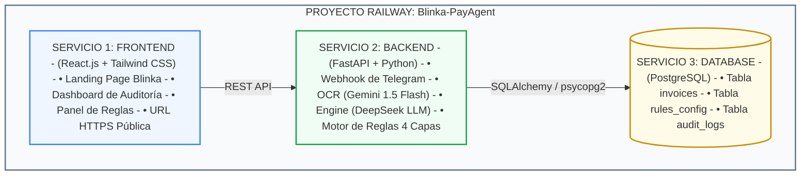
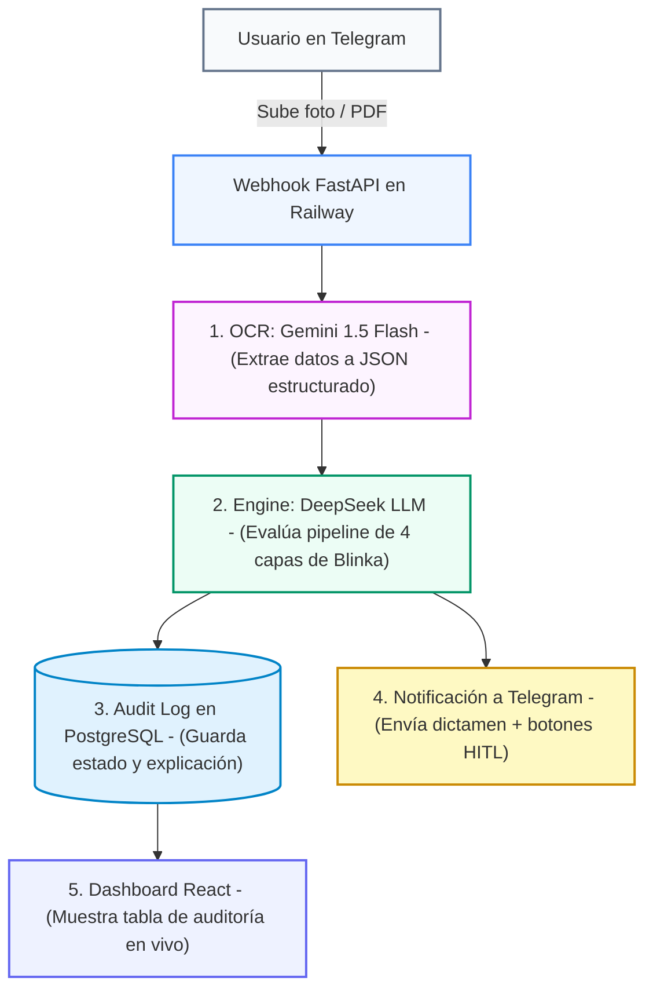

# Arquitectura de Solución v2: Blinka PayAgent (Hackathon 30X)

## 1. Visión General del Sistema

**Blinka PayAgent** es un agente inteligente de pagos corporativos diseñado para automatizar el procesamiento de facturas y cuentas de cobro de empresas globales operando en Latinoamérica.

La solución integra un flujo conversacional por **Telegram** para ingesta inmediata, una combinación híbrida de IA (**Gemini 1.5 Flash** para visión/OCR y **DeepSeek** para razonamiento y evaluación de reglas), una arquitectura backend basada en **FastAPI**, un frontend interactivo en **React + Tailwind CSS** y despliegue unificado en **Railway**.

---

## 2. Stack Tecnológico Confirmado

| Capa / Módulo | Tecnología Seleccionada | Función y Detalles |
| :--- | :--- | :--- |
| **Frontend** | **React.js + Tailwind CSS** | Landing Page comercial + Dashboard de Auditoría y Reglas. |
| **Backend API** | **Python 3.12 + FastAPI** | API REST, Webhooks de Telegram y orquestación del pipeline. |
| **Lector Multimodal (OCR)** | **Gemini 1.5 Flash** | Lectura de imágenes/PDFs de facturas y estructuración a JSON. |
| **Motor de Reglas (LLM)** | **DeepSeek API** | Evaluación de las 4 capas de negocio y generación de Audit Log. |
| **Canal Conversacional** | **Telegram Bot API** | Ingesta de fotos de facturas y notificaciones/aprobaciones HITL. |
| **Base de Datos** | **PostgreSQL (Railway)** | Persistencia de facturas, reglas configuradas y trazabilidad JSON. |
| **PaaS / Infraestructura** | **Railway All-in-One** | Despliegue unificado de Frontend, Backend y PostgreSQL. |

---

## 3. Arquitectura de Componentes en Railway

Todo el ecosistema convive en un único proyecto dentro del **Lienzo (Canvas) de Railway**:



---

## 4. Diagrama del Flujo de Datos (Pipeline End-to-End)



---

## 5. Especificación de Módulos de Inteligencia Artificial

### A. Módulo OCR (Gemini 1.5 Flash)
* **Entrada:** Imagen / PDF de la factura recibida por Telegram.
* **Función:** Lectura visual y estructuración directa a JSON sin pasar por herramientas de OCR pesadas.
* **Estructura Extraída:**
  ```json
  {
    "vendor_name": "Servicios Tech LatAm S.A.S.",
    "tax_id": "901.234.567-8",
    "invoice_number": "INV-2026-089",
    "amount": 1850.00,
    "currency": "USD",
    "issue_date": "2026-10-15",
    "due_date": "2026-10-30",
    "ocr_confidence_score": 0.96
  }
  ```

### B. Módulo Razonador y Reglas (DeepSeek LLM)
* **Función:** Evaluar el JSON extraído contra la base de datos de reglas, saldos y listas de cumplimiento.
* **Pipeline de 4 Capas:**
  1. **Compliance / SARLAFT:** Validación en listas OFAC/PEP y cotejo de cuenta bancaria.
  2. **Integridad & Duplicados:** Detección de duplicados (< 30 días) y umbral de confianza OCR (>85%).
  3. **Solvencia Financiera:** Verificación de saldo disponible en Blinka y presupuesto departamental.
  4. **Gobierno Human-in-the-Loop (HITL):** Límite autónomo de $2,000 USD, proveedor nuevo y ambigüedad acumulada.
* **Estados de Salida:** `AUTO_APPROVED`, `SCALED_TO_HUMAN`, `REJECTED`.

---

## 6. Esquema de Base de Datos (PostgreSQL en Railway)

```sql
-- Tabla principal de facturas procesadas
CREATE TABLE invoices (
    id UUID PRIMARY KEY DEFAULT gen_random_uuid(),
    telegram_user_id BIGINT NOT NULL,
    invoice_number VARCHAR(100),
    vendor_name VARCHAR(255) NOT NULL,
    tax_id VARCHAR(50),
    amount NUMERIC(12, 2) NOT NULL,
    currency VARCHAR(10) DEFAULT 'USD',
    status VARCHAR(30) CHECK (status IN ('AUTO_APPROVED', 'SCALED_TO_HUMAN', 'REJECTED')),
    explanation_ui TEXT NOT NULL,
    ocr_raw_data JSONB,
    audit_log_json JSONB NOT NULL,
    created_at TIMESTAMP WITH TIME ZONE DEFAULT CURRENT_TIMESTAMP
);

-- Tabla de configuración de reglas
CREATE TABLE rules_config (
    rule_code VARCHAR(20) PRIMARY KEY,
    rule_name VARCHAR(100) NOT NULL,
    is_active BOOLEAN DEFAULT TRUE,
    threshold_value NUMERIC(12, 2),
    updated_at TIMESTAMP WITH TIME ZONE DEFAULT CURRENT_TIMESTAMP
);
```

---

## 7. Estructura del Repositorio en GitHub (`Oriojas/30X_404_team`)

```text
30X_404_team/
├── backend/
│   ├── main.py              # Servidor FastAPI y Webhook de Telegram
│   ├── ocr_service.py       # Extracción con Gemini 1.5 Flash
│   ├── rules_engine.py      # Lógica de las 4 capas con DeepSeek LLM
│   ├── database.py          # Conexión SQLAlchemy a PostgreSQL
│   ├── models.py            # Modelos ORM y esquemas Pydantic
│   └── requirements.txt     # fastapi, uvicorn, google-generativeai, httpx, psycopg2-binary
├── frontend/
│   ├── src/
│   │   ├── components/      # Tablas, Badges, Tarjetas de Reglas
│   │   ├── pages/           # LandingPage.jsx y Dashboard.jsx
│   │   ├── App.jsx
│   │   └── main.jsx
│   ├── index.html
│   ├── tailwind.config.js
│   └── package.json
└── docs/
    ├── README.md
    ├── arquitectura/
    ├── reglas-negocio/
    ├── especificaciones/
    └── diseno/
```

---

## 8. Variables de Entorno en Railway

```env
# Configuración del Backend (FastAPI)
PORT=8000
DATABASE_URL=postgresql://<USUARIO>:<PASSWORD>@<HOST_RAILWAY>:5432/<DB_NAME>
TELEGRAM_BOT_TOKEN=<TU_TELEGRAM_BOT_TOKEN>
GEMINI_API_KEY=<TU_GEMINI_API_KEY>
DEEPSEEK_API_KEY=<TU_DEEPSEEK_API_KEY>

# Configuración del Frontend (React)
VITE_API_BASE_URL=https://<TU_BACKEND_RAILWAY_URL>.up.railway.app
```

---

## 9. Alineación con los Criterios de Evaluación de Blinka & 30X

* **Autonomía (30%):** Procesamiento inmediato sin intervención humana para pagos dentro de la norma.
* **Seguridad / Tolerancia Cero (20%):** Frenado automático (`REJECTED`) en casos de duplicado o alerta SARLAFT.
* **Explicabilidad (20%):** Generación del Audit Log en lenguaje natural para visualización en el Dashboard de React.
* **Viabilidad Técnica & Despliegue (15%):** Despliegue unificado en Railway con React + FastAPI + PostgreSQL.
* **Pitch & Demo (15%):** Demostración en vivo conectando Telegram con la consola web.
