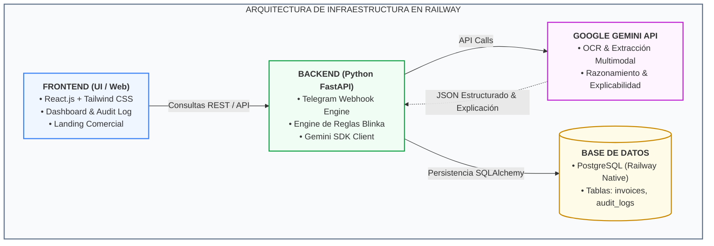
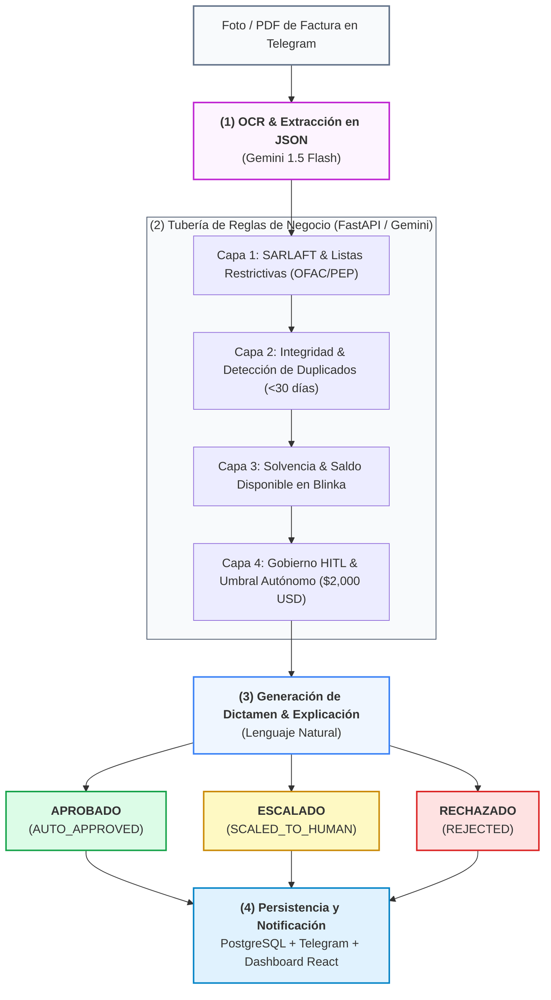

# Arquitectura Tecnológica e Infraestructura: Blinka PayAgent (v3 - Gemini All-in-One)

## 1. Visión General y Definición del Stack

La solución **Blinka PayAgent** centraliza la lectura, validación y toma de decisiones sobre facturas corporativas en un stack unificado alrededor de **Google Gemini**, eliminando la dispersión de proveedores y maximizando la velocidad de ejecución para la Hackathon 30X.

---

## 2. Componentes del Stack Tecnológico

| Capa / Componente | Tecnología Seleccionada | Rol Específico en el Sistema |
| :--- | :--- | :--- |
| **Lector Multimodal & OCR** | **Gemini 1.5 Flash** | Procesa la foto o PDF recibido desde Telegram y extrae directamente el JSON estructurado (`vendor_name`, `tax_id`, `amount`, `currency`, `due_date`, `bank_details`). |
| **Motor de Razonamiento & Reglas** | **Gemini 1.5 Flash / Pro** | Evalúa las reglas de negocio en 4 capas de Blinka y redacta la explicación en lenguaje natural para el *Audit Log*. |
| **Canal de Ingesta Conversacional** | **Telegram Bot (Webhook)** | Recibe facturas por chat y notifica dictámenes o botones de aprobación rápida (*Human-in-the-Loop*). |
| **Backend & Servidor API** | **Python 3.12 + FastAPI** | Recibe webhooks, orquesta la llamada a Gemini, consulta PostgreSQL y expone la API REST para la interfaz web. |
| **Frontend & Dashboard** | **React.js + Tailwind CSS** | Presenta la landing page comercial y la consola de auditoría con la paleta de colores de Blinka (`#04243C`, `#2B9CAE`). |
| **Base de Datos & Persistencia** | **PostgreSQL (Railway)** | Almacena las facturas procesadas, la configuración de reglas y la trazabilidad de decisiones (*Audit Log*). |
| **Infraestructura All-in-One** | **Railway** | Aloja el Frontend, Backend y PostgreSQL en un solo lienzo visual con despliegue continuo desde GitHub. |

---

## 3. Análisis de Capacidad, Créditos y Viabilidad (Gemini PRO)

**Respuesta Directa:** **SÍ, TIENES MÁS QUE SUFICIENTES CRÉDITOS.**

### Plan Gratuito (Google AI Studio - Free Tier)
* **Límite:** 15 solicitudes por minuto (RPM) / 1,500 solicitudes por día (RPD).
* **Consumo Estimado para la Hackathon:** Procesar 100 facturas de prueba consume apenas el **6.6% del límite diario**.

### Plan Pro / Pay-as-you-go
* **Costo por Factura (Gemini 1.5 Flash):**
  * Entrada (Imagen + Prompt): ~2,000 tokens \\(\approx\\) \$0.00015 USD.
  * Salida (JSON Estructurado + Explicación): ~500 tokens \\(\approx\\) \$0.00015 USD.
  * **Costo Total por Factura:** **~\$0.0003 USD (Menos de un centavo de dólar por cada 30 facturas).**
* **Conclusión:** Tener tu cuenta PRO con un único proveedor (**Gemini API Key**) te brinda capacidad prácticamente ilimitada para todas las pruebas del fin de semana sin riesgo de agotamiento.

---

## 4. Ventajas de la Centralización en Gemini

1. **Una Sola API Key (`GEMINI_API_KEY`):** Simplifica la configuración de variables de entorno en Railway y entornos locales.
2. **Cero Fricción de Integración:** Un único SDK oficial (`google-generativeai`) instalado en `requirements.txt`.
3. **Flujo de Un Solo Paso (*One-Shot Processing*):** Gemini puede leer la imagen y evaluar las reglas en una sola llamada de API si se requiere máxima velocidad, o en dos pasos estructurados (OCR \\(\rightarrow\\) Reglas) para garantizar modularidad.

---

## 5. Tubería de Decisiones del Agente (4 Capas de Reglas)

---

## 6. Entregables del Repositorio (`/docs`)

Este documento se encuentra guardado en tu repositorio bajo la ruta:
`docs/arquitectura/arquitectura_solucion_v3.md`
