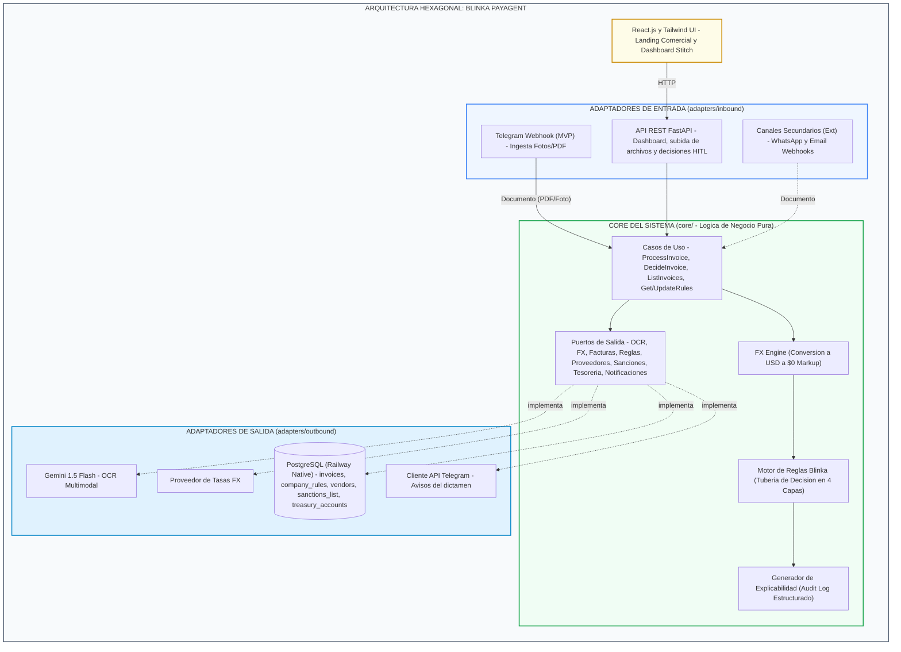
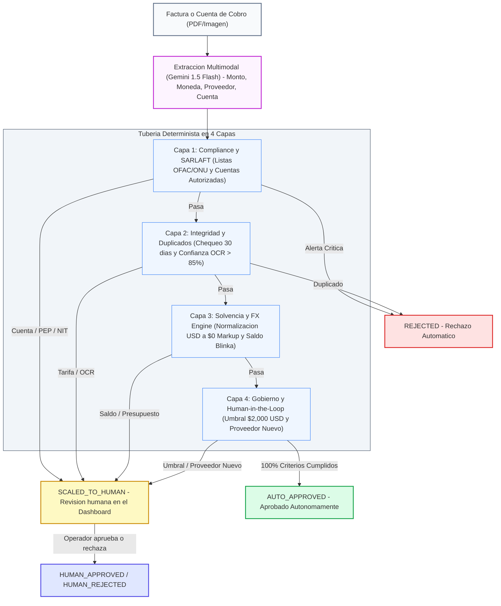

# Especificación de Arquitectura v4: Blinka PayAgent (Paybot)

> [!WARNING]
> **Documento histórico.** La arquitectura vigente, con diagramas C4 y el estado real de la implementación, está en [arquitectura_solucion_v5.md](arquitectura_solucion_v5.md).
**Proyecto:** Agentes Autónomos para Pagos Corporativos | **Hackathon 30X**
**Despliegue:** Railway All-in-One PaaS | **Repositorio:** `Oriojas/30X_404_team`

---

## 1. Visión General de la Arquitectura

Siguiendo el consenso técnico entre **Oscar Riojas** y **Luis Felipe Marín Giraldo**, la arquitectura de **Blinka PayAgent** adopta un patrón **Hexagonal (Puertos y Adaptadores)** dentro de un **Monorepo** en GitHub.

Esta arquitectura separa completamente los adaptadores de entrada (Telegram, API REST) y los adaptadores de salida (Gemini, tasas FX, PostgreSQL, notificaciones de Telegram) del **Núcleo de Negocio (Core)**, garantizando que nuevas fuentes de ingesta (como correo electrónico o WhatsApp) se puedan conectar sin modificar las reglas de procesamiento.



**Regla de dependencias:** los adaptadores dependen del Core, nunca al revés. El Core solo conoce los puertos; el *composition root* (`backend/app/container.py`) decide qué adaptador concreto implementa cada puerto. Los adaptadores de entrada reciben casos de uso por inyección y nunca importan el contenedor; `backend/tests/test_architecture.py` lo verifica automáticamente.

---

## 2. Estructura del Monorepo (`Oriojas/30X_404_team`)

```text
30X_404_team/
├── backend/                        # API FastAPI & Core Hexagonal
│   ├── app/
│   │   ├── core/                   # Hexágono: lógica de negocio pura
│   │   │   ├── domain/             # models.py, fx_converter.py, rules_pipeline.py, audit_logger.py
│   │   │   ├── ports/              # outbound.py: contratos que implementan los adaptadores
│   │   │   └── use_cases/          # process_invoice.py, query_invoices.py, manage_rules.py
│   │   ├── adapters/
│   │   │   ├── inbound/            # Adaptadores de entrada
│   │   │   │   ├── dependencies.py # Inyección de casos de uso (único punto que ve el contenedor)
│   │   │   │   ├── api/            # Routers REST y DTOs Pydantic
│   │   │   │   └── telegram/       # Webhook de Telegram
│   │   │   └── outbound/           # Adaptadores de salida
│   │   │       ├── ocr/            # Gemini 1.5 Flash
│   │   │       ├── fx/             # Proveedor de tasas de cambio
│   │   │       ├── notifications/  # Router de avisos por canal de origen
│   │   │       ├── db/             # PostgreSQL + schema.sql
│   │   │       └── telegram/       # Cliente API Telegram (notificaciones HITL)
│   │   ├── config.py               # Settings desde el .env raíz
│   │   ├── container.py            # Composition root (inyección de dependencias)
│   │   └── main.py                 # Arranque FastAPI y montaje de routers
│   ├── tests/                      # Pruebas del Core con adaptadores falsos
│   ├── requirements.txt
│   └── Dockerfile
├── frontend/                       # Aplicación React + Tailwind CSS
│   ├── src/
│   │   ├── components/             # Dashboard, Audit Table, Rule Controls
│   │   └── App.jsx
│   ├── package.json
│   └── Dockerfile
├── docs/                           # Documentación & Especificaciones
│   ├── arquitectura/arquitectura_solucion_v4.md
│   └── reglas-negocio/reglas_pago_agente_v3.md
├── plan_de_trabajo.md
└── README.md                       # Presentación del proyecto y guías
```

---

## 3. Tubería de Reglas de Negocio & FX Engine



**Política de recorrido:** un `REJECTED` detiene la tubería de inmediato y las capas siguientes quedan como `NOT_EVALUATED`. Las alertas de escalamiento se acumulan, para que el Audit Log muestre todas las capas y se pueda aplicar HITL-03. El detalle por regla está en [reglas_pago_agente_v3.md](../reglas-negocio/reglas_pago_agente_v3.md).

### Capa 1: Compliance & SARLAFT
- Cotejo automático contra listas restrictivas (OFAC, ONU, GAFI) por razón social, NIT o cuenta bancaria (`sanctions_list`).
- Validación de que la cuenta bancaria de destino pertenezca al beneficiario registrado, condición PEP y consistencia NIT / razón social (`vendors`).
- Se omite si `sarlaft_check_enabled` está desactivado.

### Capa 2: Integridad & Detección de Duplicados
- Detección de facturas duplicadas en la ventana configurada (30 días): mismo proveedor y mismo número **o** mismo monto.
- Monto mayor a la tarifa pactada en contrato (`vendors.contract_amount_usd`).
- Calidad mínima de lectura OCR (≥ 85% de confianza) y campos obligatorios presentes.

### Capa 3: Solvencia & Conversión de Divisas (FX Engine)
- **Extracción de Moneda:** Soporte para facturas en COP, MXN, EUR, BRL, ARS y USD.
- **Normalización FX:** Conversión automática a USD usando la tasa de cambio de referencia.
- **Garantía Blinka:** Transacciones con **$0.00 FX Markup**.
- **Saldo:** Verificación de saldo disponible en la cuenta USD de Blinka (`balance_usd >= usd_amount`) y colchón mínimo de tesorería.
- **Presupuesto:** El acumulado aprobado del mes más la factura no puede superar el presupuesto mensual (`treasury_accounts`).

### Capa 4: Gobierno & Human-in-the-Loop (HITL)
- **Límite Autónomo:** Aprobación automática hasta **$2,000 USD** equivalente.
- **Escalamiento:** Si la factura supera $2,000 USD, es de un proveedor nuevo o acumula 2 o más inconsistencias, queda en `SCALED_TO_HUMAN`.
- **Aprobación humana:** Se hace **solo desde el dashboard** (`POST /api/invoices/{id}/decision`). Telegram y los demás canales son únicamente de ingesta y reciben un aviso con el resultado.

---

## 4. Modelo de Datos PostgreSQL

El DDL completo está en [schema.sql](../../backend/app/adapters/outbound/db/schema.sql) y los datos de demostración en [seed.sql](../../backend/app/adapters/outbound/db/seed.sql). El backend aplica el esquema al arrancar (`DB_AUTO_MIGRATE=true`) y el seed solo si `DB_SEED_DEMO=true`; ambos son idempotentes.

| Tabla | Uso | Capa |
| :--- | :--- | :--- |
| `company_rules` | Umbrales configurables desde el dashboard (límite autónomo, SARLAFT, ventana de duplicados, colchón de tesorería) | Todas |
| `vendors` | Proveedores verificados: NIT, cuenta autorizada, condición PEP, tarifa pactada | 1, 2, 4 |
| `sanctions_list` | Listas restrictivas OFAC / ONU / GAFI | 1 |
| `treasury_accounts` | Saldo USD de la cuenta Blinka y presupuesto mensual | 3 |
| `invoices` | Audit Log: datos de la factura, conversión FX, decisión, explicación, `evaluations` (JSONB por capa) y decisión humana (`decided_by`, `decided_at`, `human_note`) | — |

---

## 5. Despliegue en Railway (All-in-One PaaS)

El proyecto se despliega dentro de un único canvas de Railway:
1. **PostgreSQL Service:** Base de datos relacional administrada.
2. **Backend Service:** FastAPI container ejecutando el webhook de Telegram y la lógica de Gemini.
3. **Frontend Service:** React.js compilado servido con URL pública HTTPS.
4. **Environment Variables:** `DATABASE_URL`, `DB_AUTO_MIGRATE`, `DB_SEED_DEMO`, `TELEGRAM_BOT_TOKEN`, `TELEGRAM_WEBHOOK_SECRET`, `GEMINI_API_KEY`.
