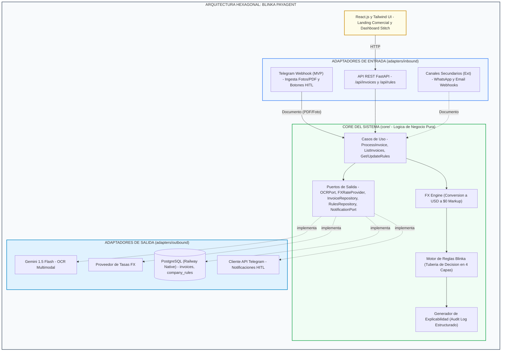
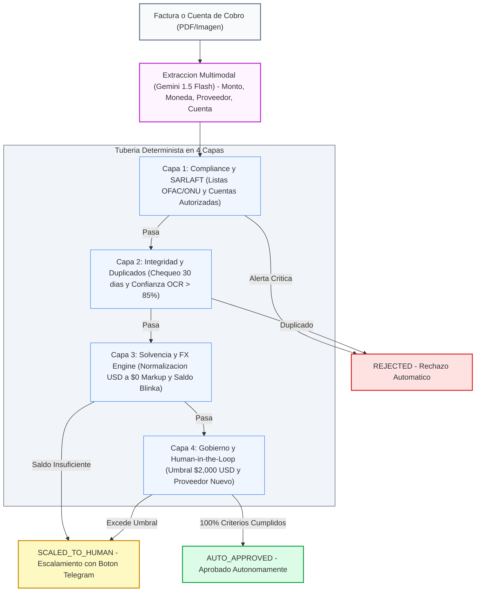

# Especificación de Arquitectura v4: Blinka PayAgent (Paybot)
**Proyecto:** Agentes Autónomos para Pagos Corporativos | **Hackathon 30X**
**Despliegue:** Railway All-in-One PaaS | **Repositorio:** `Oriojas/30X_404_team`

---

## 1. Visión General de la Arquitectura

Siguiendo el consenso técnico entre **Oscar Riojas** y **Luis Felipe Marín Giraldo**, la arquitectura de **Blinka PayAgent** adopta un patrón **Hexagonal (Puertos y Adaptadores)** dentro de un **Monorepo** en GitHub.

Esta arquitectura separa completamente los adaptadores de entrada (Telegram, API REST) y los adaptadores de salida (Gemini, tasas FX, PostgreSQL, notificaciones de Telegram) del **Núcleo de Negocio (Core)**, garantizando que nuevas fuentes de ingesta (como correo electrónico o WhatsApp) se puedan conectar sin modificar las reglas de procesamiento.



**Regla de dependencias:** los adaptadores dependen del Core, nunca al revés. El Core solo conoce los puertos; el *composition root* (`backend/app/container.py`) decide qué adaptador concreto implementa cada puerto.

---

## 2. Estructura del Monorepo (`Oriojas/30X_404_team`)

```text
30X_404_team/
├── backend/                        # API FastAPI & Core Hexagonal
│   ├── app/
│   │   ├── core/                   # Hexágono: lógica de negocio pura
│   │   │   ├── domain/             # models.py, fx_converter.py, rules_pipeline.py, audit_logger.py
│   │   │   ├── ports/              # outbound.py: contratos que implementan los adaptadores
│   │   │   └── use_cases/          # process_invoice.py, query_invoices.py, manage_rules.py
│   │   ├── adapters/
│   │   │   ├── inbound/            # Adaptadores de entrada
│   │   │   │   ├── api/            # Routers REST, DTOs Pydantic, dependencias
│   │   │   │   └── telegram/       # Webhook de Telegram
│   │   │   └── outbound/           # Adaptadores de salida
│   │   │       ├── ocr/            # Gemini 1.5 Flash
│   │   │       ├── fx/             # Proveedor de tasas de cambio
│   │   │       ├── db/             # PostgreSQL + schema.sql
│   │   │       └── telegram/       # Cliente API Telegram (notificaciones HITL)
│   │   ├── config.py               # Settings desde el .env raíz
│   │   ├── container.py            # Composition root (inyección de dependencias)
│   │   └── main.py                 # Arranque FastAPI y montaje de routers
│   ├── tests/                      # Pruebas del Core con adaptadores falsos
│   ├── requirements.txt
│   └── Dockerfile
├── frontend/                       # Aplicación React + Tailwind CSS
│   ├── src/
│   │   ├── components/             # Dashboard, Audit Table, Rule Controls
│   │   └── App.jsx
│   ├── package.json
│   └── Dockerfile
├── docs/                           # Documentación & Especificaciones
│   ├── arquitectura/arquitectura_solucion_v4.md
│   └── reglas-negocio/reglas_pago_agente_v3.md
├── plan_de_trabajo.md
└── README.md                       # Presentación del proyecto y guías
```

---

## 3. Tubería de Reglas de Negocio & FX Engine



### Capa 1: Compliance & SARLAFT
- Cotejo automático contra listas restrictivas (OFAC, ONU, listas locales).
- Validación de que la cuenta bancaria de destino pertenezca al beneficiario registrado.

### Capa 2: Integridad & Detección de Duplicados
- Detección de facturas duplicadas en un periodo de 30 días (`vendor_id` + `invoice_number`).
- Calidad mínima de lectura OCR (>85% de confianza).

### Capa 3: Solvencia & Conversión de Divisas (FX Engine)
- **Extracción de Moneda:** Soporte para facturas en COP, MXN, EUR, BRL, ARS y USD.
- **Normalización FX:** Conversión automática a USD usando la tasa de cambio de referencia.
- **Garantía Blinka:** Transacciones con **$0.00 FX Markup**.
- **Presupuesto:** Verificación de saldo disponible en la cuenta USD de Blinka (`balance_usd >= usd_amount`).

### Capa 4: Gobierno & Human-in-the-Loop (HITL)
- **Límite Autónomo:** Aprobación automática hasta **$2,000 USD** equivalente.
- **Escalamiento:** Si la factura supera $2,000 USD o es un proveedor nuevo, el bot de Telegram envía un mensaje interactivo con botones (*Inline Keyboard*) para aprobación humana en 1 clic.

---

## 4. Esquema de Base de Datos PostgreSQL

```sql
CREATE TABLE company_rules (
    id SERIAL PRIMARY KEY,
    company_id VARCHAR(50) NOT NULL,
    max_autonomous_usd NUMERIC(12,2) DEFAULT 2000.00,
    sarlaft_check_enabled BOOLEAN DEFAULT TRUE,
    duplicate_check_days INT DEFAULT 30,
    created_at TIMESTAMP DEFAULT CURRENT_TIMESTAMP
);

CREATE TABLE invoices (
    id SERIAL PRIMARY KEY,
    invoice_number VARCHAR(100) NOT NULL,
    vendor_name VARCHAR(150) NOT NULL,
    vendor_tax_id VARCHAR(50),
    original_amount NUMERIC(14,2) NOT NULL,
    original_currency VARCHAR(10) NOT NULL,
    fx_rate_applied NUMERIC(10,4),
    usd_amount NUMERIC(12,2) NOT NULL,
    due_date DATE,
    channel_source VARCHAR(30) DEFAULT 'TELEGRAM',
    decision_status VARCHAR(30) NOT NULL, -- AUTO_APPROVED, SCALED_TO_HUMAN, REJECTED
    audit_explanation TEXT NOT NULL,
    processed_at TIMESTAMP DEFAULT CURRENT_TIMESTAMP
);
```

---

## 5. Despliegue en Railway (All-in-One PaaS)

El proyecto se despliega dentro de un único canvas de Railway:
1. **PostgreSQL Service:** Base de datos relacional administrada.
2. **Backend Service:** FastAPI container ejecutando el webhook de Telegram y la lógica de Gemini.
3. **Frontend Service:** React.js compilado servido con URL pública HTTPS.
4. **Environment Variables:** `DATABASE_URL`, `TELEGRAM_BOT_TOKEN`, `GEMINI_API_KEY`.
