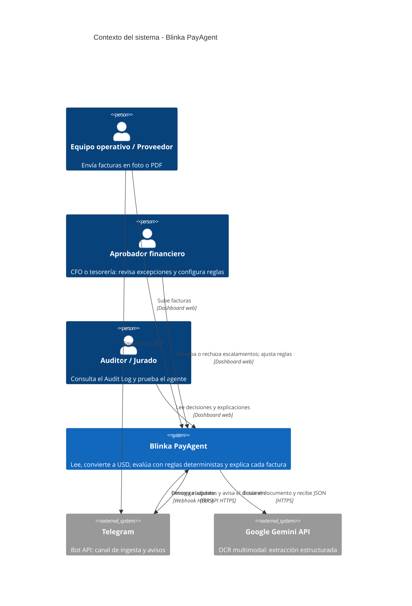
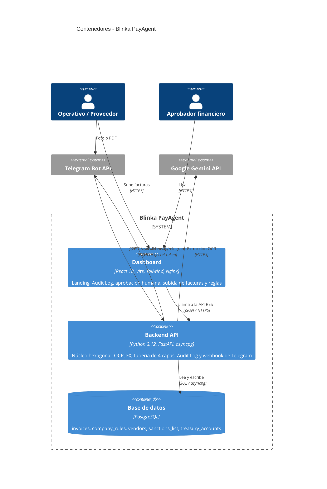
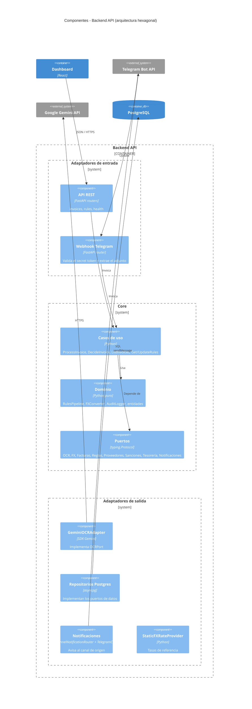
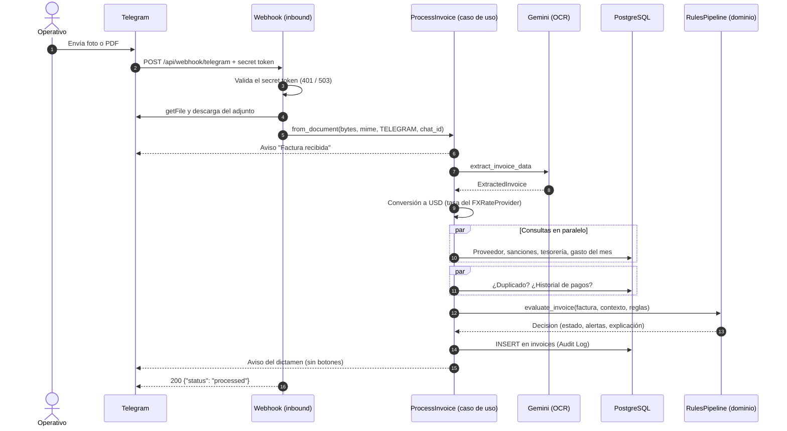
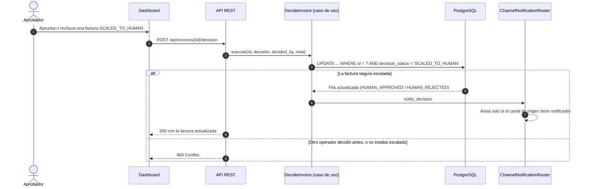
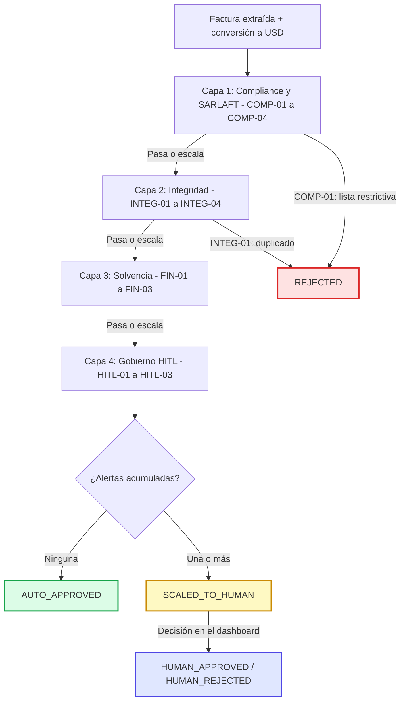
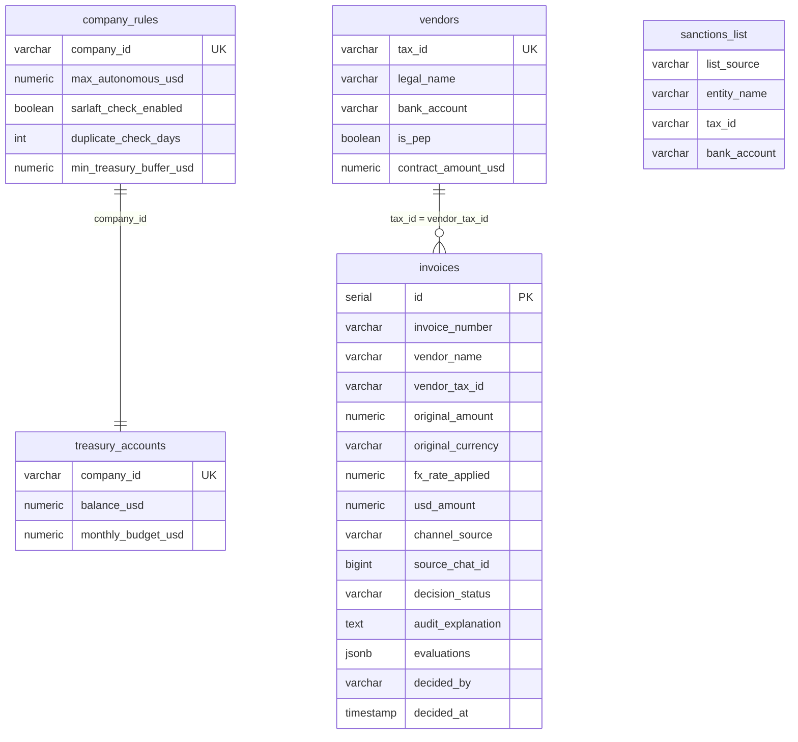
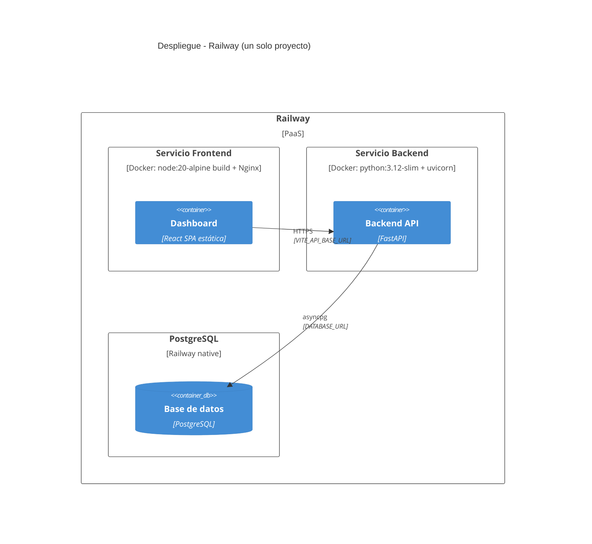

# Arquitectura de Solución v5: Blinka PayAgent (Paybot)
**Proyecto:** Agentes Autónomos para Pagos Corporativos | **Hackathon 30X — Reto Blinka**
**Estado:** VIGENTE desde el 17 de octubre de 2026 (reemplaza a la [v4](arquitectura_solucion_v4.md)) | **Repositorio:** `Oriojas/30X_404_team`

> Describe la arquitectura **tal como está implementada** en `backend/` y `frontend/`, usando el modelo **C4** (Contexto → Contenedores → Componentes → Código).
> Los principios y el alcance están en [specs/mission.md](../../specs/mission.md), el stack en [specs/tech-stack.md](../../specs/tech-stack.md) y lo pendiente en [specs/roadmap.md](../../specs/roadmap.md).
> Las reglas de negocio detalladas (códigos COMP, INTEG, FIN, HITL) están en [reglas_pago_agente_v3.md](../reglas-negocio/reglas_pago_agente_v3.md).

**Novedades frente a la v4:**
- La aprobación humana ocurre **solo en el dashboard**; los canales (Telegram, web) únicamente ingresan facturas.
- Hexágono explícito: puertos, casos de uso y composition root, con una prueba automática de arquitectura.
- Nuevas tablas para las reglas (`vendors`, `sanctions_list`, `treasury_accounts`), ingesta web y estados `HUMAN_*`.

---

## 1. Nivel 1 — Diagrama de Contexto

Quién usa el sistema y con qué sistemas externos se comunica.

**Fuera del sistema (por alcance del reto):** no se ejecutan pagos reales, no hay conexión con la cuenta bancaria de Blinka (el saldo vive en la tabla `treasury_accounts`) y no hay KYB.

---

## 2. Nivel 2 — Diagrama de Contenedores

Las piezas desplegables y cómo se comunican.

| Contenedor | Tecnología | Responsabilidad | Código |
| :--- | :--- | :--- | :--- |
| **Dashboard** | React 18 + Vite + Tailwind, servido con Nginx | UI del equipo financiero; consume la API en `VITE_API_BASE_URL` | `frontend/` |
| **Backend API** | FastAPI + asyncpg + httpx | Toda la lógica del agente y los canales de ingesta | `backend/app/` |
| **Base de datos** | PostgreSQL (Railway native; probado con 16) | Reglas, datos de referencia y Audit Log | `backend/app/adapters/outbound/db/schema.sql` |

---

## 3. Nivel 3 — Diagrama de Componentes del Backend (Hexágono)

Los adaptadores de salida **implementan** los puertos; el Core nunca los importa. `container.py` (composition root) crea cada adaptador y lo inyecta en los casos de uso. Los routers reciben los casos de uso con `adapters/inbound/dependencies.py`, el único punto de los adaptadores que ve el contenedor.

### Regla de dependencias (verificada por `backend/tests/test_architecture.py`)

| Capa | Puede importar | No puede importar |
| :--- | :--- | :--- |
| `core/domain` | Librería estándar, `core/domain` | Puertos, casos de uso, frameworks, adaptadores |
| `core/ports` | `core/domain` | Casos de uso, frameworks, adaptadores |
| `core/use_cases` | `core/domain`, `core/ports` | Frameworks, adaptadores |
| `adapters/inbound` | Core, FastAPI | Adaptadores de salida, `container`, `config`, `main` |
| `adapters/outbound` | Core, SDKs (asyncpg, httpx, Gemini) | Adaptadores de entrada, `container`, `config`, `main` |
| `container.py` / `main.py` | Todo | — |

Además, todos los imports son absolutos desde `app` y el Core solo depende de la librería estándar.

---

## 4. Nivel 4 — Código

| Ruta (`backend/app/`) | Contenido |
| :--- | :--- |
| `core/domain/models.py` | Entidades: `ExtractedInvoice`, `Vendor`, `TreasuryStatus`, `CompanyRules`, `Decision`, `ProcessedInvoice`, `DecisionStatus` |
| `core/domain/rules_pipeline.py` | Tubería determinista de 4 capas y generación de la explicación |
| `core/domain/fx_converter.py` | Conversión pura a USD ($0.00 markup) |
| `core/domain/audit_logger.py` | Construye el registro del Audit Log |
| `core/domain/errors.py` | `InvoiceNotFoundError`, `InvalidDecisionStateError` |
| `core/ports/outbound.py` | Contratos de los adaptadores de salida |
| `core/use_cases/` | `process_invoice.py`, `decide_invoice.py`, `query_invoices.py`, `manage_rules.py` |
| `adapters/inbound/api/` | Routers REST (`routers/`) y DTOs Pydantic (`schemas.py`) |
| `adapters/inbound/telegram/webhook.py` | Webhook con su propio puerto `TelegramFileSource` |
| `adapters/outbound/db/` | `postgres_repository.py`, `schema.sql`, `seed.sql` |
| `adapters/outbound/ocr/gemini_ocr.py` | Adaptador OCR (**stub** hasta la Fase 1 del roadmap) |
| `adapters/outbound/fx/static_rates.py` | Tasas fijas; `None` si la moneda no está soportada |
| `adapters/outbound/notifications/channel_router.py` | Enruta avisos por canal de origen |
| `adapters/outbound/telegram/telegram_client.py` | `getFile`, descarga de adjuntos y `sendMessage` |
| `config.py` · `container.py` · `main.py` | Settings, composition root, arranque y manejo de errores |

---

## 5. Vista Dinámica — Flujo de una Factura

### 5.1 Ingesta por Telegram

La **subida web** (`POST /api/invoices/upload`) sigue el mismo camino desde el paso 5, con canal `WEB` y sin avisos. `POST /api/invoices` entra directo en `from_extracted`, sin OCR.

### 5.2 Decisión humana en el dashboard

---

## 6. Tubería Determinista de 4 Capas

- **Un `REJECTED` corta** la evaluación: las capas siguientes quedan `NOT_EVALUATED`.
- **Las alertas de escalamiento se acumulan**, para registrar todas las capas y poder aplicar HITL-03.
- Con `sarlaft_check_enabled = false`, la Capa 1 queda `SKIPPED`. Con moneda no soportada (INTEG-04), la Capa 3 también queda `SKIPPED`.
- Cada capa se guarda en `invoices.evaluations` (JSONB) con su estado (`PASSED`, `TRIGGERED`, `SKIPPED`, `NOT_EVALUATED`) y sus alertas.

---

## 7. Modelo de Datos

La relación entre `vendors` e `invoices` es **lógica** (por NIT o razón social), no una clave foránea: una factura puede ser de un proveedor que todavía no está en el registro (HITL-02). El DDL completo está en [schema.sql](../../backend/app/adapters/outbound/db/schema.sql) y los datos ficticios en [seed.sql](../../backend/app/adapters/outbound/db/seed.sql).

---

## 8. API REST

| Método | Ruta | Uso |
| :--- | :--- | :--- |
| `GET` | `/api/health` | Estado del servicio y de la conexión a PostgreSQL |
| `GET` | `/api/invoices` | Audit Log (arreglo JSON, con `evaluations` por capa) |
| `POST` | `/api/invoices` | Evaluar una factura con datos estructurados (sin OCR) |
| `POST` | `/api/invoices/upload` | Ingesta web: JPG, PNG, WEBP o PDF, máx. 10 MB |
| `POST` | `/api/invoices/{id}/decision` | Decisión humana (`404` / `409`) |
| `GET` / `POST` | `/api/rules` | Consultar o actualizar umbrales |
| `POST` | `/api/webhook/telegram` | Ingesta por Telegram (`401` sin token válido, `503` sin secret configurado) |

---

## 9. Despliegue (Railway)

| Variable | Servicio | Uso |
| :--- | :--- | :--- |
| `DATABASE_URL` | Backend | Conexión a PostgreSQL. Sin ella, los endpoints de datos responden `503` |
| `DB_AUTO_MIGRATE` / `DB_SEED_DEMO` | Backend | Aplicar `schema.sql` / cargar datos ficticios de demo |
| `GEMINI_API_KEY` / `GEMINI_MODEL` | Backend | OCR |
| `TELEGRAM_BOT_TOKEN` / `TELEGRAM_WEBHOOK_SECRET` | Backend | Canal Telegram (registrar `setWebhook` con `secret_token`) |
| `ALLOWED_ORIGINS` | Backend | CORS: URL del dashboard |
| `VITE_API_BASE_URL` | Frontend | URL pública del backend |

El backend aplica el esquema al arrancar, así que no hace falta ejecutar el DDL a mano. El paso a paso está en la Fase 4 del [roadmap](../../specs/roadmap.md).

---

## 10. Seguridad y Fallas Seguras

| Riesgo | Mitigación implementada |
| :--- | :--- |
| Aprobar un pago indebido | Reglas deterministas; la IA solo extrae datos. Sin datos de tesorería se asume saldo 0, y toda factura escala |
| Moneda desconocida o mal leída | Nunca se convierte 1:1: escala por INTEG-04 |
| OCR fallido o ilegible | Extracción vacía con confianza 0: escala por INTEG-03 |
| Llamadas falsas al webhook | Secret token de Telegram comparado en tiempo constante; sin secret configurado, el webhook responde 503 |
| Dos operadores deciden a la vez | `UPDATE` condicionado al estado `SCALED_TO_HUMAN`: solo gana uno, el otro recibe 409 |
| Datos ficticios en producción | El seed solo se carga con `DB_SEED_DEMO=true` |
| Falla al notificar | Se registra en el log y no revierte la decisión ya guardada |

---

## 11. Decisiones de Arquitectura

| # | Decisión | Motivo |
| :--- | :--- | :--- |
| 1 | Arquitectura hexagonal con prueba automática | Sumar canales (email, WhatsApp) o cambiar proveedores sin tocar las reglas |
| 2 | La IA solo extrae; las reglas deciden | Reproducibilidad, auditoría y tolerancia cero |
| 3 | Los canales solo ingresan facturas; la aprobación ocurre en el dashboard | Separar a quien envía de quien autoriza, y registrar quién decide |
| 4 | Estados `HUMAN_*` separados de `AUTO_*` | Medir la autonomía real del agente |
| 5 | SQL explícito con asyncpg (sin ORM) | Pocas tablas, consultas simples y control total de la idempotencia del esquema |
| 6 | Tasas FX fijas | Demo reproducible; reemplazables por un proveedor en vivo vía `FXRateProvider` |
| 7 | SDK `google-genai` para Gemini | SDK oficial vigente; `google-generativeai` está deprecado |
| 8 | Esquema migrado al arrancar; seed opcional | Despliegue en Railway sin pasos manuales, sin datos ficticios por defecto |

---

## 12. Estado de Implementación

| Pieza | Estado |
| :--- | :--- |
| Hexágono, tubería de 4 capas, Audit Log, decisión humana, API REST | ✅ Implementado y probado (incluida la integración con PostgreSQL) |
| Webhook de Telegram (secret token, descarga y avisos) | ✅ Implementado; sin probar contra la API real de Telegram |
| OCR con Gemini | ⏳ Stub — Fase 1 del roadmap |
| Ingesta idempotente por canal | ⏳ Fase 2 |
| Dashboard conectado a la API real | ⏳ Fase 3 |
| Despliegue en Railway con estas variables | ⏳ Fase 4 |
