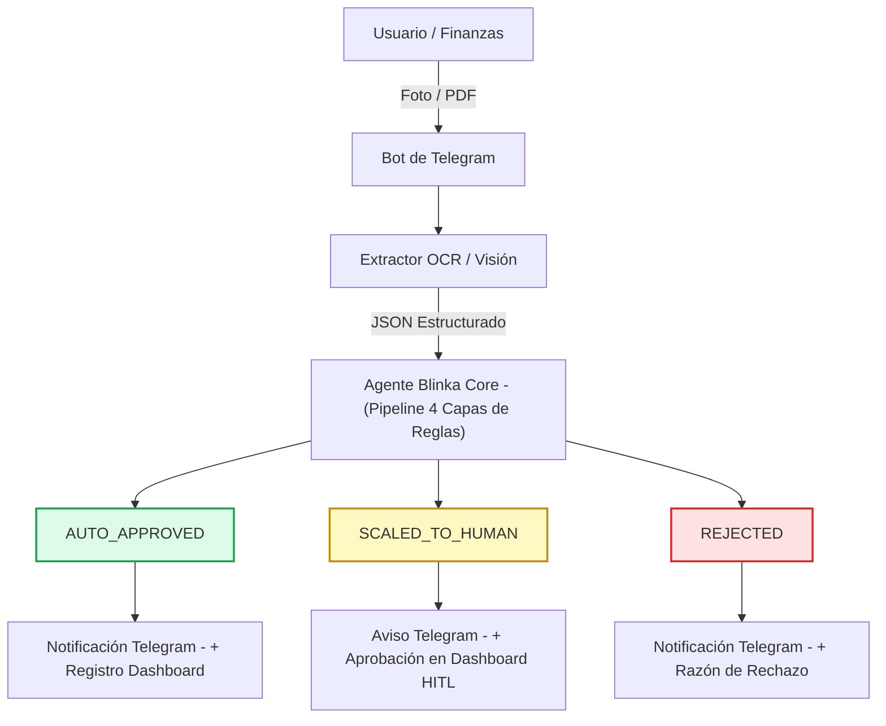

# Documento de Especificaciones de la Solución: Agente de Pagos Blinka (Telegram + OCR + Dashboard)

## 1. Resumen de la Solución y Propuesta de Valor

**Nombre del Proyecto (Sugerido):** Blinka PayBot / Blinka AgentPay  
**Objetivo:** Eliminar el trabajo manual de gestión de facturas para empresas globales con operaciones en Latinoamérica, permitiendo enviar la foto o PDF de una factura desde un **chat de Telegram**, procesarla mediante **OCR / IA de Visión**, evaluarla contra **reglas de negocio y compliance (SARLAFT)**, y gestionar aprobaciones en un **Dashboard / Landing Web**.

---

## 2. Componentes de la Arquitectura

### Componente A: Bot de Telegram (Interfaz de Ingesta y Notificación Operativa)
* **Función:** Canal de ingesta rápido para el equipo operativo y proveedores. Recibe facturas e informa resultados; no toma decisiones de aprobación.
* **Flujo de Usuario:**
  1. El usuario toma una foto a la factura física o reenvía el archivo PDF al chat del bot.
  2. El bot responde instantáneamente: `" Factura recibida. Analizando datos con OCR y evaluando reglas de seguridad..."`.
  3. Una vez procesada por el agente, Telegram recibe el dictamen final:
     * **Aprobada (`AUTO_APPROVED`):** Se notifica que el pago cumple con las reglas y queda programado.
     * **Escalada (`SCALED_TO_HUMAN`):** Se muestra la razón de escalamiento (ej. *"Monto excede $2,000 USD"* o *"Proveedor Nuevo"*) y se indica que la factura quedó en revisión en el dashboard. Telegram **no aprueba**: es solo canal de ingesta.
  4. Cuando un operador aprueba o rechaza la factura en el dashboard, el bot avisa el resultado final al mismo chat.
     * **Rechazada (`REJECTED`):** Se notifica el motivo de bloqueo (ej. *"Cobro duplicado"* o *"Incompatibilidad SARLAFT"*).

---

### Componente B: Módulo OCR y Extracción Estructurada (Visión LLM)
* **Función:** Convertir la imagen/PDF de la factura en un objeto JSON limpio y tipado.
* **Datos a Extraer:**
  * `vendor_name`: Razón social del proveedor.
  * `tax_id`: NIT / RUT / Tax ID fiscal.
  * `invoice_number`: Número de factura o cuenta de cobro.
  * `amount`: Valor total a pagar.
  * `currency`: Moneda (`USD`, `COP`, `MXN`, `BRL`, etc.).
  * `due_date`: Fecha límite de pago.
  * `bank_details`: Banco, número de cuenta, tipo de cuenta, SWIFT/IBAN o datos de pago.
  * `ocr_confidence_score`: Valor de 0.0 a 1.0 sobre la legibilidad de la imagen.

---

### Componente C: Agente Blinka Core (Motor de Reglas y Decisión)
* **Función:** Ejecutar la evaluación en 4 capas secuenciales definida en las políticas de Blinka (`reglas-pago-agente-v3.md`):
  1. **Capa 1 (Compliance / SARLAFT):** Verificación en listas negras OFAC/ONU y coherencia de NIT.
  2. **Capa 2 (Integridad / Duplicados):** Detección de facturas o montos duplicados en los últimos 30 días.
  3. **Capa 3 (Solvencia Financiera):** Verificación de saldo disponible en la cuenta Blinka.
  4. **Capa 4 (Umbrales HITL):** Monto máximo autónomo ($2,000 USD) y estatus de proveedor nuevo.
* **Resultado:** Objeto `Audit Log` con explicación en lenguaje natural.

---

### Componente D: Landing Page y Dashboard Web
* **Función:** Presentar la propuesta de valor comercial de la solución para el Demo Day y proveer la consola de administración.
* **Secciones de la Landing Page:**
  * **Hero Section:** *"Agentes autónomos que gestionan las facturas de tu empresa global con la seguridad de Blinka"*.
  * **Explicación del Flujo:** Cómo el bot de Telegram + OCR elimina el 90% de la carga manual.
  * **Demostración Interactiva / Live Dashboard:**
    * **Panel de Métricas:** Total procesado, % de autonomía, ahorro de tiempo estimado.
    * **Historial de Facturas (Tabla de Auditoría):** Lista de facturas con su estado (`AUTO_APPROVED`, `SCALED_TO_HUMAN`, `REJECTED`, `HUMAN_APPROVED`, `HUMAN_REJECTED`) y el desglose de reglas evaluadas.
    * **Aprobación Humana (HITL):** Único punto donde se aprueban o rechazan las facturas escaladas, registrando quién decidió y cuándo.
    * **Subida de Facturas:** Canal de ingesta web (foto o PDF) para que el jurado pruebe el agente sin Telegram.
    * **Consola de Configuración de Reglas:** Slider o inputs para ajustar el límite de aprobación autónoma ($USD), habilitar checks SARLAFT y definir aprobadores humanos.

---

## 3. Matriz de Integración de Tecnologías (Tech Stack Recomendado)

| Capa | Tecnología Sugerida | Justificación / Ventaja en Hackathon |
| :--- | :--- | :--- |
| **Interfaz Móvil** | Telegram Bot API (`python-telegram-bot` / `Telegraf`) | Fácil integración, no requiere instalar apps adicionales. |
| **OCR / Visión** | OpenAI GPT-4o-mini / Gemini Flash Vision | Alta precisión en lectura de facturas arrugadas o fotos de baja calidad; entrega JSON estructurado directamente. |
| **Backend / Agente** | Python (FastAPI) / Node.js | Rápido de construir, ejecuta las reglas deterministas en milisegundos. |
| **Frontend / Landing** | Next.js + Tailwind CSS + v0.dev / Lovable | Permite desplegar una landing page y un dashboard estéticamente profesional en pocas horas. |
| **Despliegue Demo** | Vercel (Frontend) / Render o Railway (Backend Bot) | Despliegue con URL pública garantizado para la evaluación del jurado. |

---

## 4. Estructura del Repositorio (`/docs`)

Guarda este documento en tu repositorio público bajo la ruta:
`docs/especificacion_solucion.md`

Este documento conecta la visión funcional de la interfaz (Telegram + Landing) con la lógica rigurosa de reglas que definimos en `reglas-pago-agente-v3.md`, asegurando que el equipo trabaje coordinado durante el fin de semana.
