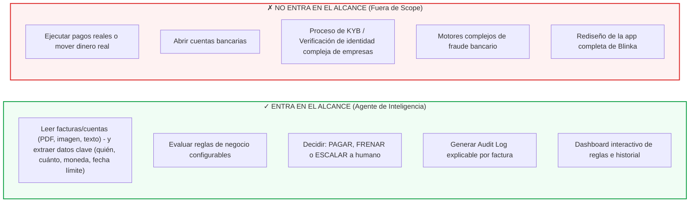
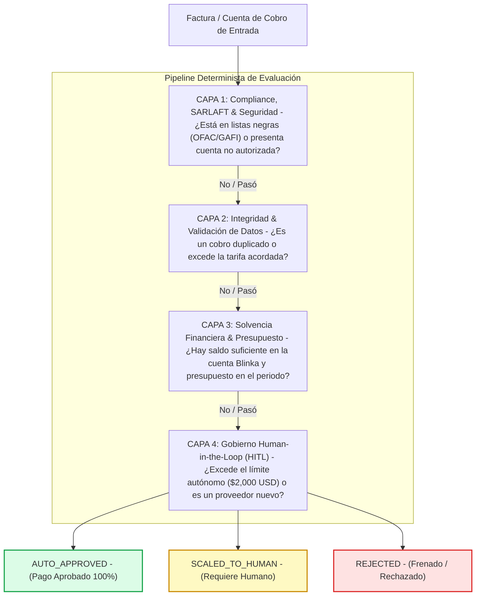

# Especificación Técnica y Reglas de Negocio: Agente de Pagos Blinka (v3 - Edición Kickoff 30X)

## 1. Visión General, Alcance y Alineación con el Reto Blinka

### El Problema Operativo
Las empresas globales constituidas en EE. UU. que operan en Latinoamérica enfrentan cuellos de botella mensuales al procesar decenas de cuentas de cobro y facturas en múltiples monedas. El proceso actual es manual, fragmentado (vía correo, PDF o chat), lento y propenso a errores humanos o fraudes.

### Delimitación Oficial del Alcance (Ficha del Reto)



---

## 2. Criterios de Evaluación Oficiales de la Hackathon 30X y Éxito de Blinka

### Matriz de Ponderación Oficial de la Hackathon (Scorecard del Jurado)

| Criterio de Evaluación | Ponderación | Enfoque de Aplicación en el Agente de Blinka |
| :--- | :---: | :--- |
| **Impacto del Reto** | **30%** | Demostrar cómo se elimina la carga operativa manual de finanzas, reduciendo tiempos de procesamiento de horas a segundos. |
| **Innovación** | **20%** | Tubería determinista de 4 capas + Explicabilidad en lenguaje natural + Gobierno *Human-in-the-Loop* configurable. |
| **Viabilidad Técnica** | **20%** | Código funcional en el repositorio público que respalde exactamente la experiencia mostrada en el demo en vivo. |
| **Viabilidad de Implementación**| **15%** | Arquitectura ligera y de bajo costo operativo por factura, fácil de adoptar sin dependencias complejas o modelos costosos. |
| **Presentación y Pitch** | **15%** | Video de 3 minutos ágil y directo al grano, enfocado en mostrar la demo funcionando y el impacto de negocio. |

### Criterios de Éxito Específicos de Blinka

1. **Autonomía:** Porcentaje de facturas que el agente procesa correctamente sin requerir intervención humana.
2. **Seguridad (Tolerancia Cero):** Cero pagos aprobados fuera de las reglas. **Nota vital:** Aprobar un pago indebido o no autorizado descalifica automáticamente al proyecto.
3. **Explicabilidad:** Cualquier operador financiero o auditor puede comprender por qué el agente **PAGÓ**, **FRENÓ** o **ESCALÓ** una factura leyendo su registro en lenguaje natural, sin abrir el código fuente.

---

## 3. Especificación de Entregables Obligatorios (Cierre Domingo 11:59 AM)

Para cumplir estrictamente con los requisitos del Kickoff, el equipo entregará tres elementos antes del **domingo 18 de octubre a las 11:59 AM**:

1. **Video Pitch (Máximo 3 minutos):**
   * **0:00 - 0:30 | Problema:** Presentar el dolor operativo de las empresas pagando facturas manuales en LatAm.
   * **0:30 - 2:00 | Demo Funcional:** Demostración en vivo del agente procesando facturas normales y casos trampa, mostrando cómo la UI refleja las decisiones y la explicación.
   * **2:00 - 3:00 | Impacto y Viabilidad:** Explicación del ROI, costo operativo por factura, arquitectura segura e integración con Blinka.
2. **Demo Desplegado (URL Pública):**
   * Plataforma accesible desde navegador donde el jurado (incluyendo al CTO de Blinka) pueda interactuar con el panel de control, probar facturas y verificar las reglas.
3. **Repositorio Público (GitHub):**
   * Código fuente completo bajo licencia Open Source (MIT) con la carpeta `docs/` que incluye este documento (`reglas_pago_agente_v3.md`).

---

## 4. Arquitectura de Decisiones en 4 Capas (Pipeline Determinista)

El agente procesa cada factura de forma determinista mediante una tubería (*pipeline*) secuencial. Si falla una prueba crítica en las capas iniciales, la decisión se detiene de inmediato para garantizar la seguridad.

**Política de recorrido (implementada en `backend/app/core/domain/rules_pipeline.py`):**
* Una regla con decisión `REJECTED` detiene la tubería; las capas siguientes quedan como `NOT_EVALUATED`.
* Las reglas `SCALED_TO_HUMAN` se acumulan: se evalúan todas las capas para que el Audit Log muestre cada alerta y se pueda aplicar HITL-03.
* Si la Capa 1 está desactivada (`sarlaft_check_enabled = false`), queda como `SKIPPED`.



---

## 5. Matriz Completa de Reglas de Negocio

### Capa 1: Compliance y Prevención SARLAFT (Colombia & LatAm)

> **Objetivo:** Evitar transacciones con personas o entidades sancionadas, respetando el marco SARLAFT para la gestión del riesgo de lavado de activos y financiación del terrorismo.

| Código | Nombre de la Regla | Condición Lógica | Decisión | Razón / Explicación Registrada |
| :--- | :--- | :--- | :--- | :--- |
| **COMP-01** | **Listas Restrictivas (OFAC/ONU)** | Beneficiario registrado en OFAC, ONU o listas de sanciones GAFI. | `REJECTED` | *Rechazado por coincidencia con lista restrictiva internacional.* |
| **COMP-02** | **Cuentas Bancarias No Permitidas** | Las instrucciones de transferencia difieren de las cuentas validadas del proveedor. | `SCALED_TO_HUMAN` | *Instrucciones bancarias no coinciden con las cuentas autorizadas.* |
| **COMP-03** | **Alerta PEP (Políticamente Expuesto)** | El beneficiario o representante figura en el registro PEP. | `SCALED_TO_HUMAN` | *Escalado a Oficial de Cumplimiento por condición PEP.* |
| **COMP-04** | **Consistencia Identificación Fiscal** | NIT / RUT en la factura no coincide con la razón social registrada. | `SCALED_TO_HUMAN` | *Inconsistencia entre el NIT impreso y el registro fiscal.* |

---

### Capa 2: Integridad de la Factura y Verificación de Datos

> **Objetivo:** Prevenir pagos por cobros duplicados, errores de extracción de datos o facturas alteradas.

| Código | Nombre de la Regla | Condición Lógica | Decisión | Razón / Explicación Registrada |
| :--- | :--- | :--- | :--- | :--- |
| **INTEG-01** | **Detección de Cobro Duplicado** | Mismo ID Factura + Proveedor O mismo Monto + Proveedor en < 30 días. | `REJECTED` | *Factura rechazada por detección de cobro duplicado.* |
| **INTEG-02** | **Desviación de Tarifa Pactada** | Monto cobrado en la factura > Monto acordado en contrato/PO. | `SCALED_TO_HUMAN` | *El valor cobrado supera la tarifa acordada en el contrato.* |
| **INTEG-03** | **Calidad de Extracción (OCR/LLM)** | Confidence score en lectura de datos de la factura < 85%. | `SCALED_TO_HUMAN` | *Lectura de factura ambigua o ilegible. Requiere revisión.* |
| **INTEG-04** | **Moneda No Soportada** | La moneda de la factura no tiene tasa en el FX Engine. Nunca se asume 1:1; la Capa 3 queda `SKIPPED` porque no hay monto en USD. | `SCALED_TO_HUMAN` | *Moneda no soportada por el FX Engine: no es posible normalizar el monto a USD.* |

---

### Capa 3: Solvencia Financiera y Presupuesto

> **Objetivo:** Garantizar la disponibilidad de liquidez en la cuenta de Blinka y el respeto a los techos presupuestales.

| Código | Regla | Condición Lógica | Decisión | Razón / Explicación Registrada |
| :--- | :--- | :--- | :--- | :--- |
| **FIN-01** | **Verificación de Saldo Existente** | `Monto Factura > Saldo Cuenta Blinka` (USD o Moneda Local). | `SCALED_TO_HUMAN` | *Saldo insuficiente en la cuenta Blinka para ejecutar el pago.* |
| **FIN-02** | **Tope Presupuestal del Período** | Acumulado de pagos del mes + Monto Factura > Presupuesto Asignado. | `SCALED_TO_HUMAN` | *El pago excede el presupuesto disponible del período.* |
| **FIN-03** | **Colchón Mínimo de Tesorería** | `Saldo Cuenta Blinka - Monto Factura < Colchón mínimo` (configurable, `min_treasury_buffer_usd`). Solo aplica si no se disparó FIN-01. | `SCALED_TO_HUMAN` | *El pago dejaría la cuenta Blinka por debajo del colchón mínimo de tesorería.* |

---

### Capa 4: Umbrales y Gobierno Human-in-the-Loop (HITL)

> **Objetivo:** Detener la autonomía cuando se superen los niveles de riesgo aceptados por la administración.

| Código | Regla | Condición Lógica | Decisión | Razón / Explicación Registrada |
| :--- | :--- | :--- | :--- | :--- |
| **HITL-01** | **Monto Máximo de Aprobación Autónoma** | `Monto Factura > $2,000 USD` (Umbral configurable). | `SCALED_TO_HUMAN` | *El monto excede el límite autónomo de $2,000 USD.* |
| **HITL-02** | **Proveedor Nuevo (Primer Pago)** | El proveedor no cuenta con historial de pagos en la plataforma. | `SCALED_TO_HUMAN` | *Proveedor nuevo. Requiere verificación inicial por un operador.* |
| **HITL-03** | **Ambigüedad Acumulada** | 2 o más alertas de inconsistencia de la factura (COMP-02, COMP-04, INTEG-02, INTEG-03, INTEG-04). | `SCALED_TO_HUMAN` | *Acumulación de pequeñas inconsistencias detectadas.* |

### Resolución Humana de Facturas Escaladas

* Las facturas en `SCALED_TO_HUMAN` se aprueban o rechazan **únicamente desde el dashboard**. Telegram y los demás canales son solo de ingesta: informan el resultado, pero no aprueban.
* La decisión es atómica: si dos operadores deciden a la vez, solo se registra la primera.
* La decisión humana mueve la factura a `HUMAN_APPROVED` o `HUMAN_REJECTED` y registra quién decidió, cuándo y una nota opcional. Así la métrica de autonomía distingue lo que resolvió el agente de lo que resolvió una persona.
* Solo se pueden decidir facturas en `SCALED_TO_HUMAN`. Un `REJECTED` automático (OFAC, duplicado) no se puede aprobar.

---

## 6. Matriz de Casos de Prueba Simulados (Test Suite Obligatorio)

Set de datos simulados diseñado para verificar el comportamiento del agente frente a facturas legítimas y a los **casos trampa requeridos**. Los datos de soporte (proveedores, listas restrictivas, saldo de $8,500 USD e historial) están en `backend/app/adapters/outbound/db/seed.sql`, y la suite se ejecuta automáticamente en `backend/tests/test_postgres_integration.py`:

| ID Caso | Descripción del Caso de Prueba | Tipo de Caso | Resultado Esperado | Regla Disparada |
| :--- | :--- | :--- | :--- | :--- |
| **TC-01** | Factura mensual recurrente de AWS ($450 USD) con saldo suficiente y proveedor frecuente. | Normal | `AUTO_APPROVED` | Ninguna (Pasó 100%) |
| **TC-02** | Factura enviada por segunda vez en la misma semana ($1,200 USD). | **Trampa (Duplicado)** | `REJECTED` | `INTEG-01` |
| **TC-03** | Factura de proveedor nuevo no registrado previamente ($800 USD). | **Trampa (Proveedor Nuevo)** | `SCALED_TO_HUMAN` | `HITL-02` |
| **TC-04** | Factura con monto superior al pactado ($3,500 USD vs $2,000 USD de límite). | **Trampa (Monto Alto)** | `SCALED_TO_HUMAN` | `HITL-01` |
| **TC-05** | Factura por $10,000 USD cuando el saldo en Blinka es de $4,000 USD. | **Trampa (Saldo Insuficiente)** | `SCALED_TO_HUMAN` | `FIN-01` |
| **TC-06** | Factura con destino a cuenta bancaria en lista restrictiva OFAC. | **Trampa (Compliance)** | `REJECTED` | `COMP-01` |
| **TC-07** | Factura de AWS por $1,500 USD cuando la tarifa pactada en contrato es de $1,000 USD (proveedor frecuente, bajo el umbral autónomo). | **Trampa (No cuadra con lo acordado)** | `SCALED_TO_HUMAN` | `INTEG-02` |

---

## 7. Estructura del Registro de Decisiones (Audit Log JSON)

Cada evaluación produce un registro que alimenta directamente la interfaz web para garantizar la **explicabilidad total** (`GET /api/invoices`):

```json
{
  "id": 14,
  "invoice_number": "INV-2026-104",
  "vendor_name": "DevStudio LatAm S.A.S.",
  "vendor_tax_id": "900.584.112-4",
  "original_amount": 10500000.00,
  "original_currency": "COP",
  "fx_rate_applied": 4200.0,
  "usd_amount": 2500.00,
  "due_date": "2026-10-31",
  "ocr_confidence_score": 0.98,
  "channel_source": "TELEGRAM",
  "decision_status": "SCALED_TO_HUMAN",
  "evaluations": {
    "compliance_check": { "status": "PASSED", "alerts": [] },
    "integrity_check": {
      "status": "TRIGGERED",
      "alerts": [{ "reason_code": "INTEG-02", "message": "El valor cobrado ($2,500.00 USD) supera la tarifa acordada en el contrato ($1,500.00 USD)." }]
    },
    "solvency_check": { "status": "PASSED", "alerts": [] },
    "hitl_check": {
      "status": "TRIGGERED",
      "alerts": [{ "reason_code": "HITL-01", "message": "El monto de $2,500.00 USD excede el límite autónomo de $2,000.00 USD." }]
    },
    "fx": { "usd_amount": 2500.00, "fx_rate_applied": 4200.0, "blinka_fx_markup": "0.00 USD" }
  },
  "audit_explanation": "Pago de $2,500.00 USD (10,500,000 COP a tasa 4,200.00) escalado a revisión humana: [INTEG-02] ... [HITL-01] ...",
  "processed_at": "2026-10-17T15:42:10",
  "decided_by": null,
  "decided_at": null,
  "human_note": null
}
```

Los estados posibles de `status` por capa son `PASSED`, `TRIGGERED`, `SKIPPED` y `NOT_EVALUATED`.

---

## 8. Checklist de Verificación para la Entrega (Cierre Domingo 11:59 AM)

* [ ] Repositorio público en GitHub con licencia Open Source.
* [ ] Archivo `docs/reglas_pago_agente_v3.md` cargado en el repositorio.
* [ ] URL del Demo funcionando con la suite de pruebas (casos normales y casos trampa).
* [ ] Video Pitch de 3 minutos subido (mostrando problema, demo en vivo e impacto).
* [ ] Formulario de entrega enviado en HackRadar antes de las 11:59 AM del domingo.
