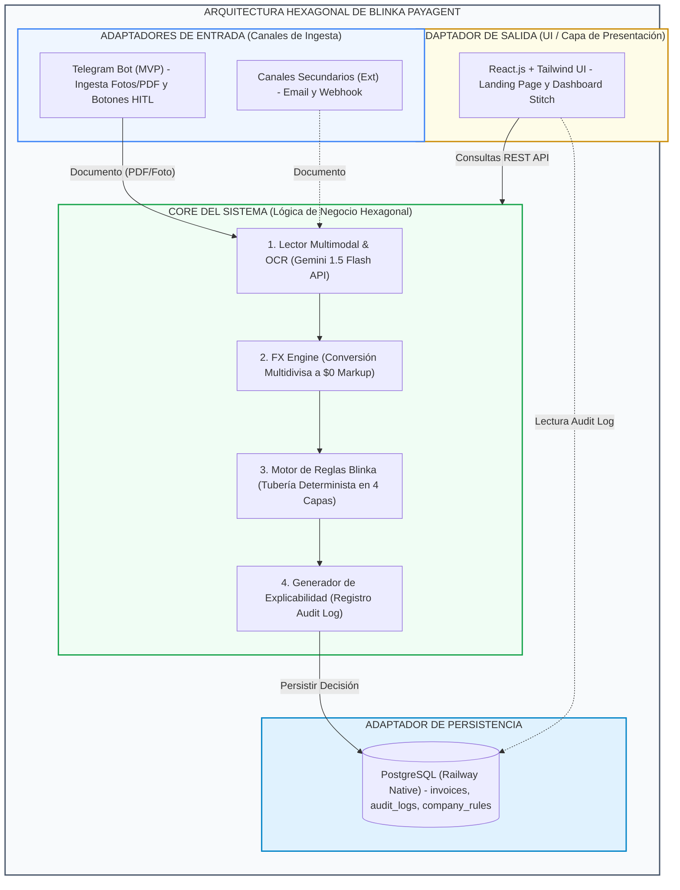
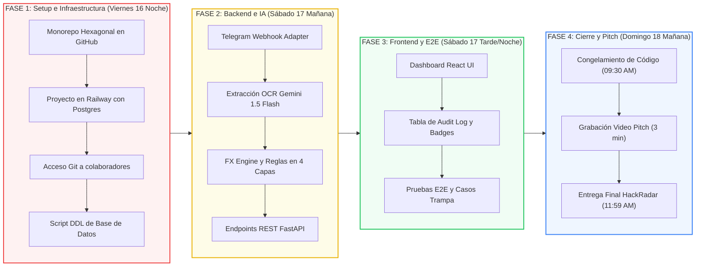

# Plan de Trabajo Oficial: Blinka PayAgent (Paybot)
**Proyecto para Hackathon 30X | Equipo 404**
**Repositorio GitHub:** `Oriojas/30X_404_team`
**Fecha de Inicio:** 16 de Octubre de 2026 | **Fecha Límite de Entrega:** 18 de Octubre de 2026 - 11:59 AM (GMT-5)

---

## 1. Resumen Ejecutivo del Proyecto

**Blinka PayAgent (Paybot)** es un agente autónomo e inteligente de gestión y control de pagos corporativos diseñado para empresas globales que operan con equipos y proveedores en Latinoamérica. Permite recibir facturas y cuentas de cobro desde múltiples canales (iniciando con un bot interactivo de Telegram como MVP), extraer la información mediante visión multimodal (Gemini 1.5 Flash), evaluar el pago contra una tubería de reglas de negocio de 4 capas (incluyendo conversión de divisas en tiempo real), y registrar cada decisión en un panel de auditoría (*Audit Log*) completamente explicable.

---

## 2. Arquitectura Técnica Hexagonal y Componentes Unificados

Basado en los acuerdos de la reunión con **Luis Felipe Marín Giraldo**, la solución adopta una **Arquitectura Hexagonal (Puertos y Adaptadores)** dentro de un **Monorepo** centralizado y desplegado en **Railway (All-in-One)**.



---

## 2.1 Reglas Estrictas de Configuración y Documentación del Monorepo

Para garantizar orden, portabilidad y evitar dispersión de configuraciones en el equipo:

1. **Un solo archivo `.env` en el directorio raíz:**
   - Todas las variables de entorno (Backend FastAPI, PostgreSQL, Telegram Bot, Gemini API y Frontend Vite) se declaran en el archivo raíz `.env`.
   - El repositorio incluye un único archivo plantilla `.env.example` en la raíz con valores ficticios y documentados. Está estrictamente prohibido crear archivos `.env` o `.env.example` dentro de subcarpetas (`backend/` o `frontend/`).
2. **Un solo archivo `.gitignore` en el directorio raíz:**
   - Un único archivo centralizado `.gitignore` en la raíz gobierna las exclusiones de todo el proyecto (Python, Node.js, artefactos de build, variables de entorno y logs). Queda prohibido crear archivos `.gitignore` anidados.
3. **Estructura Documental de READMEs:**
   - **README principal:** Ubicado en la raíz (`README.md`), presenta la visión general de la solución, arquitectura, guía de inicio rápido y referencias directas a los submódulos.
   - **README de Backend:** Ubicado en `backend/README.md`, detalla los endpoints, configuración de FastAPI, dependencias y arquitectura hexagonal.
   - **README de Frontend:** Ubicado en `frontend/README.md`, detalla los componentes React, diseño con Tailwind CSS y conexión con la API.

---

## 3. Módulo Especial: Regla de Conversión de Divisas (FX Engine)

Uno de los requerimientos clave del Reto Blinka es la gestión de operaciones multidivisa (pagos a proveedores en Latinoamérica en monedas locales como COP, MXN, EUR, BRL o ARS desde una cuenta corporativa en USD).

### Flujo de Conversión de Divisas:
1. **Extracción Multimodal (Gemini 1.5 Flash):** El OCR identifica el monto original (`original_amount`) y la moneda original (`original_currency`, ej: $1,500,000 COP, €450 EUR, $12,000 MXN).
2. **Normalización a USD (FX Engine):**
   - El Core consulta/aplica la tasa de cambio vigente (`fx_rate`).
   - Calcula el valor equivalente en dólares (`usd_amount = original_amount / fx_rate`).
   - Aplica el **$0.00 FX Markup** garantizado por las tarjetas y cuentas corporativas de Blinka.
3. **Evaluación contra las Reglas en USD:**
   - **Umbral de Autonomía:** Se compara el `usd_amount` contra el límite máximo autónomo (ej: **$2,000 USD**).
   - **Verificación de Saldo Blinka:** Se valida que la cuenta USD posea suficiente saldo disponible (`balance_usd >= usd_amount`).
   - **Presupuesto Mensual:** Se verifica que no se exceda el cupo acumulado en USD del periodo.
4. **Registro Audit Log Explicable:** Cada factura registrada guarda en la base de datos:
   ```json
   {
     "original_amount": 1500000.00,
     "original_currency": "COP",
     "fx_rate_applied": 4200.00,
     "blinka_fx_markup": "0.00 USD",
     "converted_usd_amount": 357.14,
     "evaluation": "AUTO_APPROVED",
     "reason": "Monto de $357.14 USD ($1,500,000 COP a tasa 4,200 COP/USD) está dentro del límite autónomo ($2,000 USD) y el proveedor está verificado."
   }
   ```

---

## 4. División de Trabajo y Asignación de Responsabilidades

### 👨‍💻 Luis Felipe Marín Giraldo — Lead Backend & Bot Developer
* **Estructura Backend:** Arquitectura Hexagonal en Python con FastAPI.
* **Canal Telegram:** Webhook adapter con procesamiento de fotos y documentos PDF.
* **Visión & OCR:** Integración del SDK de Gemini 1.5 Flash para extracción estructurada JSON.
* **Lógica de Negocio:** Pipeline de validación en 4 capas y módulo de conversión de divisas (FX Engine).
* **Persistencia:** Modelado, conexión y consultas en PostgreSQL (Railway Native).

### 🎨 Oscar Riojas — Lead Frontend, Product & Pitch
* **Documentación & Monorepo:** Arquitectura técnica, diagramas y Plan de Trabajo en GitHub (`Oriojas/30X_404_team`).
* **Frontend React:** UI con Tailwind CSS adaptando el diseño Stitch para visualización móvil y desktop.
* **Dashboard & Audit Log:** Integración REST con FastAPI para renderizar trazabilidad y explicabilidad en vivo.
* **Comercial & Pitch:** Guion comercial, edición del Video Pitch (3 minutos) y presentación para el Demo Day.

---

## 5. Cronograma de Ejecución por Fases (Viernes 16 - Domingo 18)



### 🔴 FASE 1: Setup e Infraestructura Monorepo (Viernes 16 - Noche)
- [x] **Monorepo:** Configurar estructura hexagonal en `Oriojas/30X_404_team`.
- [x] **Reglas de Monorepo:** Centralización en un solo `.env` y un solo `.gitignore` en el directorio raíz.
- [x] **Estructura Documental:** Creación de `README.md` principal, `backend/README.md` y `frontend/README.md`.
- [x] **Railway Setup:** Proyecto `Blinka-PayAgent` en Railway con PostgreSQL, Backend FastAPI y Frontend React.
- [x] **Git Access:** Compartir acceso de GitHub a Luis Felipe Marín Giraldo y establecer ramas `main` y `develop`.
- [ ] **Base de Datos:** Ejecutar script DDL inicial en PostgreSQL (`invoices`, `company_rules`).

### 🟡 FASE 2: Backend, OCR & Reglas de Negocio (Sábado 17 - Mañana)
- [ ] **Telegram Adapter:** Servidor FastAPI recibiendo Webhooks y fotos/PDFs de Telegram.
- [ ] **Gemini OCR Module:** Extracción estructurada JSON con Gemini 1.5 Flash.
- [ ] **FX Engine & Business Rules:** Lógica de conversión de monedas y evaluación de las 4 capas de negocio.
- [ ] **REST Endpoints:** Exposición de endpoints `/api/invoices` y `/api/rules` para el dashboard.

### 🟢 FASE 3: Frontend React, Dashboard & Pruebas E2E (Sábado 17 - Tarde / Noche)
- [ ] **React Dashboard:** Implementación del diseño Stitch con paleta de colores Blinka.
- [ ] **Audit Log Table:** Tabla interactiva mostrando insignias de estado y explicaciones en lenguaje natural.
- [ ] **Pruebas de Casos Normales y Casos Trampa:**
  1. Factura normal aprobada automáticamente.
  2. Factura duplicada (Frenada - `REJECTED`).
  3. Proveedor no verificado en SARLAFT (Frenada - `REJECTED`).
  4. Factura en divisas que supera límite $2,000 USD (Escalada a humano - `SCALED_TO_HUMAN`).
  5. Interacción interactiva desde Telegram con botones *Inline Keyboards* para aprobar escalamientos.

### 🔵 FASE 4: Cierre, Video Pitch & Entrega (Domingo 18 - Mañana)
- [ ] **Congelamiento de Código:** Cierre de commits a las 09:30 AM.
- [ ] **Video Pitch (3 Minutos):** Grabación enfocada en propuesta de valor comercial, demostración en vivo de Telegram + Dashboard, y ROI.
- [ ] **Publicación de Repositorio:** README final actualizado con documentación y link desplegado.
- [ ] **Entrega Final:** Subida en la plataforma HackRadar antes de las 11:59 AM.

---

## 6. Criterios de Éxito de la Solución (Alineación con Hackathon 30X)

1. **Autonomía (30% Impacto):** El agente procesa y decide el 100% de las facturas estándar sin intervención humana.
2. **Seguridad (Zero-Tolerance):** Cero pagos no autorizados. Detección infalible de duplicados, alertas SARLAFT y conversiones de moneda estrictas.
3. **Explicabilidad:** Registro claro en lenguaje natural para que el equipo financiero entienda la decisión de inmediato.
4. **Viabilidad de Implementación:** Despliegue en producción funcional en Railway con cero tiempo de caída (*Zero Downtime*).
